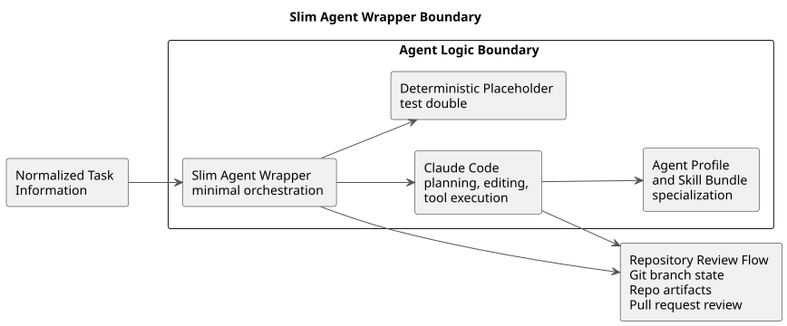
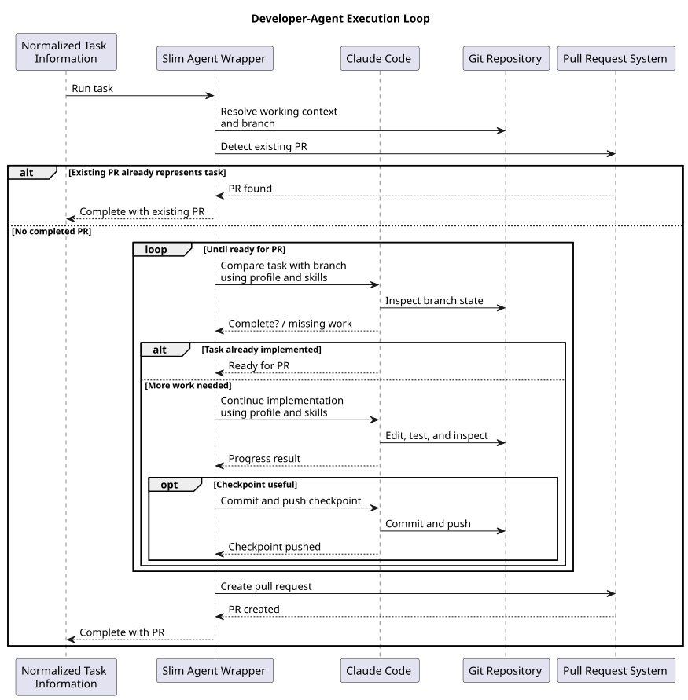

# Slim Agent Wrapper Design

## Status
Proposed

## Terminology

- **Agent** — The Slim Wrapper + Claude Code combination defined in this ADR. Portable and platform-agnostic. Owns task execution logic entirely. Has no knowledge of the underlying infrastructure.
- **Worker** — The infrastructure-specific component defined in ADR 002. Provides platform communication: queue polling, message acknowledgement, and retry handling. Hosts an Agent but is not aware of its internals.

> **Architectural consequence:** Migrating from one cloud platform to another (e.g. AWS → Azure) only requires replacing the Worker implementation. The Agent remains unchanged. A single Worker can also host different Agent types (developer agent, architecture agent, BA agent) without modification.

## Context
The agent proof of concept needs an internal agent implementation that runs inside the worker runtime described in ADR 002. ADR 002 defines the event pipeline from Jira ingestion to the worker runtime. This ADR covers only the agent logic that runs inside that runtime after a work item has been received.

Claude Code is the intended primary reasoning and coding runtime. The internal implementation should make Claude Code usable in a repeatable operational flow without becoming a competing general-purpose agent framework.

The first proof of concept is a developer agent that relies on a basic Dotnet-oriented skill set plus common skills such as Git conventions. The longer-term intent is that the same skeleton can support other specialized agents, such as architecture agents that draft ADRs or business analysis agents that break work into tickets, by changing the skills and prompts rather than rewriting wrapper logic.

Pull requests are the right finalization path for the first developer and architecture workflows because their output can live in a repository and be reviewed through the existing Git flow. Pull requests should not be treated as the only possible finalization mechanism for the generic skeleton. A business analysis agent might eventually publish to Jira or Confluence, but that external publishing behavior is outside this proof of concept; such an agent can still produce ticket or page proposals as repository artifacts.

The system also needs a deterministic placeholder implementation for early end-to-end testing. That placeholder is useful for validating the event pipeline, workspace setup, commits, pushes, and pull request behavior, but it is not the target agent design.

Component boundary:



## Problem
The worker runtime needs to process Jira-assigned coding tasks, but the project should not reimplement planning, editing, tool execution, and general coding intelligence that Claude Code already provides. This creates a boundary and specialization problem: the internal layer must provide deterministic operational orchestration while preserving Claude Code as the primary agent runtime.

If the internal layer grows into a large custom agent framework, the proof of concept will duplicate hard agent capabilities, increase maintenance cost, and blur ownership between the event pipeline, the Worker, and the coding runtime.

## Options Considered

### Option 1 — Deterministic Placeholder Agent Only
Use a deterministic implementation that reads the queued task, prepares a workspace, makes predefined changes, commits them, and pushes a branch.

**Pros**
- Easy to test end-to-end.
- Predictable behavior for validating the Jira-to-worker pipeline.
- No dependency on Claude Code availability during infrastructure testing.
- Useful for checking branch, commit, push, and pull request mechanics.

**Cons**
- Does not solve real coding tasks.
- Can create false confidence if treated as the production agent.
- Requires replacement once the proof of concept moves beyond pipeline validation.

### Option 2 — Large Custom Agent Framework
Build an internal framework that owns planning, tool execution, editing strategies, retry logic, coding heuristics, and task decomposition.

**Pros**
- Gives the team full control over agent behavior.
- Could support multiple model or tool backends behind one internal abstraction.
- Allows highly customized planning and execution policies.

**Cons**
- Duplicates capabilities that Claude Code already provides.
- Adds substantial engineering and maintenance cost before the proof of concept has proven value.
- Makes failures harder to diagnose because reasoning, tool use, and orchestration become internally owned.
- Risks coupling the worker to a bespoke framework that will be difficult to replace.

### Option 3 — Direct Claude Code Invocation From the Worker
Have the Worker call Claude Code directly with minimal setup and no meaningful internal wrapper.

**Pros**
- Smallest internal implementation.
- Keeps Claude Code clearly responsible for reasoning and coding.
- Fastest path to a working Claude Code-backed proof of concept.

**Cons**
- Branch naming, workspace preparation, checkpointing, pushing, and pull request handling can become scattered through worker code.
- Harder to test operational behavior independently from Claude Code behavior.
- Makes it less clear where repository conventions, task setup, and execution safeguards belong.
- Provides little room for deterministic test doubles.

### Option 4 — Slim Internal Wrapper Over Claude Code
Build a small internal agent layer that prepares the task, selects the relevant skill bundle, invokes Claude Code in a bounded loop, records progress through skill-guided atomic commits where applicable, and finalizes work through the configured agent profile. For the first developer-agent proof of concept, finalization means creating or detecting a pull request.

**Pros**
- Keeps Claude Code as the primary reasoning and coding runtime.
- Gives the system a deterministic place for setup, conventions, checkpointing, and integration behavior.
- Supports a placeholder implementation for end-to-end tests without changing the worker pipeline.
- Avoids committing to a broad internal agent framework before the proof of concept proves the need.
- Keeps agent logic separate from the webhook, queueing, retry, and DLQ concerns in ADR 002.
- Allows future agents to specialize through skills and prompts instead of wrapper forks.

**Cons**
- Still requires careful wrapper design to avoid gradual expansion into a custom framework.
- Depends on Claude Code being available and suitable in the worker runtime.
- Requires clear conventions for prompts, skills, profiles, branch names, commits, pushes, and finalization behavior where those behaviors apply.
- Some failures will cross the boundary between wrapper orchestration and Claude Code execution.

## Decision
Use a slim internal agent layer as a thin wrapper over Claude Code.

The wrapper will own deterministic operational orchestration around the coding runtime. Claude Code will remain responsible for planning, code editing, tool execution, and general coding intelligence.

At a high level, the developer-agent profile will:

1. Receive a normalized work item from the event pipeline defined in ADR 002.
2. Fetch the task details needed to run the agent.
3. Prepare or locate the working context according to the configured skills and profile.
4. Derive or resolve the branch according to the configured convention.
5. Detect whether an existing pull request already represents completed work for the task.
6. Ask Claude Code to compare the task with the current branch and decide whether the task is already implemented.
7. If the task is not complete, ask Claude Code to continue the implementation using the selected skills, prompts, and repository conventions.
8. Optionally run a commit-and-push prompt that creates an atomic progress checkpoint for idempotency.
9. Repeat the compare, continue, and checkpoint loop until Claude Code exits with a clear completion signal, such as "we are done and ready to create a pull request."
10. Create a pull request only after that completion signal, or detect and report the existing pull request.

For this proof of concept, completed work should be represented in the repository. Developer-agent outputs will use branch and pull request workflows. Architecture-agent outputs, such as ADRs, can use the same repository and pull request workflow. Business-analysis-style outputs should be expressed as repository artifacts, such as ticket proposals, rather than published directly to Jira or Confluence.

Specialization should come from Claude Code skills, prompts, repository conventions, and small deterministic wrapper logic. Skills may include deterministic code as well as instructions. The wrapper should not reimplement planning, code editing, tool execution, commit policy, or general coding intelligence when those behaviors can live in skills.

The deterministic placeholder implementation may remain for infrastructure and integration testing, but it is a test double for the wrapper contract rather than the target agent runtime.

This is a Claude Code orchestration wrapper and skill-bundle skeleton, not a general internal agent framework.

Developer-agent execution loop:



## Consequences

### Positive
- The proof of concept can use Claude Code's existing coding capabilities instead of rebuilding them.
- The Worker has a clear internal boundary: event handling comes from ADR 002, while task execution orchestration belongs to this Agent.
- The first Dotnet proof of concept can validate the skeleton using a concrete technology-specific skill set.
- Skills, prompts, and repository conventions become the main specialization mechanism for developer, architecture, business analysis, and other future agents.
- Repository-based outputs keep the first proof of concept reviewable without adding Jira or Confluence publishing behavior.
- Commit granularity can be guided by skills, allowing organization-specific knowledge without hard-coding it into the wrapper.
- A placeholder implementation can validate the full pipeline without pretending to be the production agent.
- The design leaves room to swap or extend runtime invocation later without making the event pipeline depend on agent internals.

### Negative
- The wrapper still needs enough structure to run selected skills, preserve state, and return useful status to the worker.
- The system depends on Claude Code behavior and availability inside the worker runtime.
- Poorly scoped additions could turn the wrapper into the large custom framework this ADR avoids.
- Debugging may require separating wrapper failures from Claude Code execution failures.
- Agent-specific conventions must be documented and kept stable enough for repeated autonomous runs.
- Deferring behavior to skills makes skill quality and versioning important to operational correctness.
- Agents that eventually need to publish directly to systems such as Jira or Confluence will require follow-on design beyond this proof of concept.

## ❓ Open Questions
1. What exact branch naming convention should the wrapper use for Jira-driven work?
2. Which workspace and branching behaviors belong in the reusable skeleton, and which should be configured by specialized skills or agent profiles?
3. How should skill bundles be versioned so a completed run can be traced back to the exact skills and prompts used?
4. What profile contract should represent non-PR finalization when future agents publish directly to Jira, Confluence, or other systems?
5. Is the exit-code + JSON stdout contract sufficient for the Worker, or does the Agent need a richer status reporting channel?

## ⚙️ Implementation Notes
The Agent exposes a small contract to the Worker: accept a normalized task input, run the configured agent implementation, and return enough status for the Worker to decide whether message processing succeeded.

The wrapper should support at least two implementations:

- Claude Code-backed implementation for target behavior.
- Deterministic placeholder implementation for local and end-to-end pipeline tests.

The first proof of concept should use a Dotnet-oriented skill bundle plus common skills for Git and repository operation. That validates the skeleton with a real developer-agent specialization.

The developer-agent loop should use distinct Claude Code prompts for:

- Checking whether the current branch already satisfies the task.
- Continuing implementation when the task is not complete.
- Creating an atomic commit and pushing progress when a checkpoint is useful.
- Signaling that the branch is complete and ready for pull request creation.

Pull requests should not be created early as draft progress markers. For developer-agent and architecture-agent runs in this proof of concept, the wrapper should create a pull request only after the completion signal, or detect that an appropriate pull request already exists.

External publishing to systems other than pull requests is out of scope for this proof of concept. Business-analysis-style agents can still fit the skeleton by writing proposed Jira tickets, Confluence pages, or other analysis artifacts into the repository for review.

Commit granularity should be guided by skills rather than fixed in the wrapper. More frequent commits are useful as a fallback strategy for idempotency and recovery, but the skill bundle should be allowed to define what counts as an atomic commit for the discipline and repository.

The reusable skeleton should own only minimal behavior:

- Loading the selected agent profile or skill bundle.
- Passing normalized task input into the runtime.
- Invoking Claude Code or the deterministic placeholder.
- Preserving enough run state for idempotency and worker status.
- Returning completion, checkpoint, failure, or finalization-ready status to the Worker.

Developer-specific behavior such as workspace preparation, branch handling, commit policy, push behavior, and pull request creation should be implemented as profile behavior or skills where practical, rather than becoming mandatory behavior for every future agent type.

The wrapper should not own:

- Jira webhook ingestion.
- Webhook validation or event normalization.
- Queue retry and dead-letter behavior.
- General planning or coding intelligence.
- Reimplementation of Claude Code tool execution.

### Deployment Artifact

The Agent is packaged as a Docker image containing at minimum:

- Claude Code CLI
- GitHub CLI (`gh`)
- Git

The Worker runs the image and injects environment variables and secrets. Packaging the Agent as an image keeps it portable — it is not coupled to any specific cloud provider.

### Agent-Worker Interface

The Worker starts the Agent by running the Docker image with the following inputs:

**Input (environment variables):**

| Variable | Description |
|----------|-------------|
| `TASK_KEY` | Jira issue key (e.g. `PROJ-123`) |
| `REPO_URL` | Git repository URL |
| `BASE_BRANCH` | Branch to check out and branch from |
| `GITHUB_TOKEN` | GitHub API token (injected as a secret) |
| `ANTHROPIC_API_KEY` | Claude API key (injected as a secret) |

**Output/Status:**

The Agent exits with a standard exit code and writes a structured status object to stdout (JSON):

| Exit code | Meaning | JSON payload |
|-----------|---------|--------------|
| `0` | Success | `{"status": "success", "pr_url": "..."}` |
| `1` | Failure | `{"status": "failed", "reason": "..."}` |
| `2` | Checkpoint | `{"status": "checkpoint", "branch": "..."}` |

**Invocation example:**

```shell
docker run --rm \
  -e TASK_KEY=PROJ-123 \
  -e REPO_URL=https://github.com/org/repo \
  -e BASE_BRANCH=main \
  -e GITHUB_TOKEN=$GITHUB_TOKEN \
  -e ANTHROPIC_API_KEY=$ANTHROPIC_API_KEY \
  <registry>/agent-developer:latest
```

The Worker reads the exit code and JSON payload to decide whether to delete the message, extend the visibility timeout, or route to the dead-letter queue.

> **Note:** The exact variables, exit codes, and JSON schema are a draft for the first PoC and will be locked down in the implementation phase. Open Question 5 tracks whether this contract needs a richer reporting channel.

## Related
- Jira ticket: Not yet assigned.
- ADR 002: [AWS Hooked Agent Event Pipeline Design](../002_hooked_agent_event_pipeline/002_hooked_agent_event_pipeline.md)
