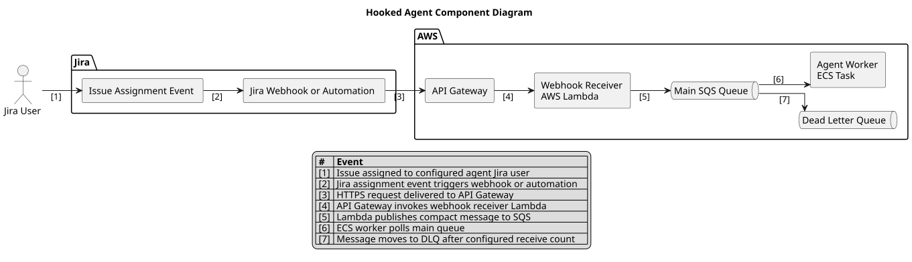
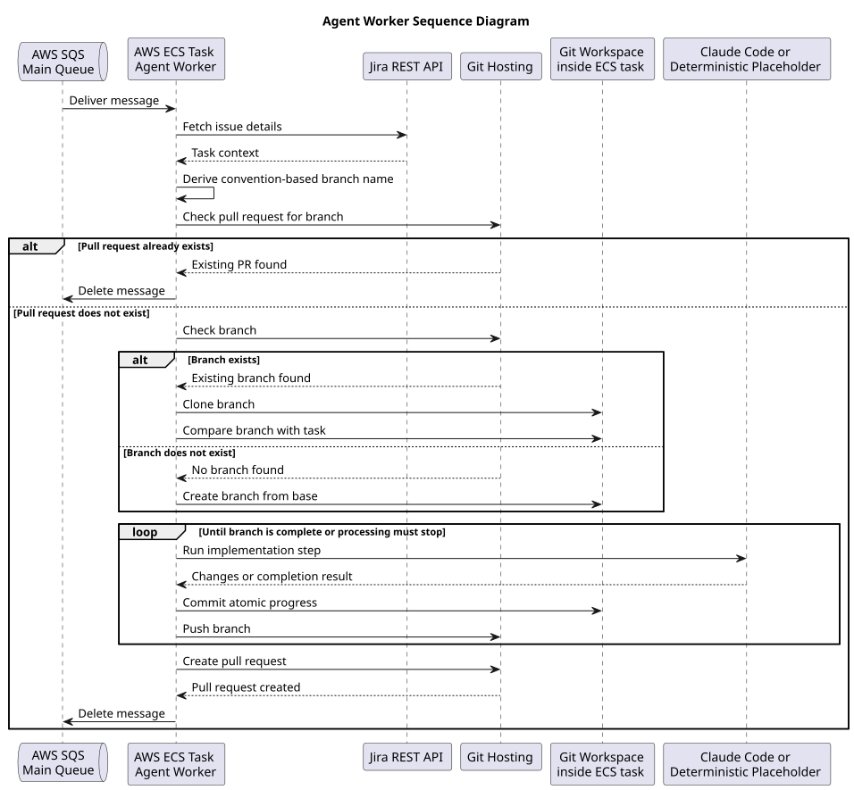

# AWS Hooked Agent Event Pipeline Design

## Status
Proposed

## Context
> **Scope:** This ADR describes the AWS-specific deployment of the Hooked Agent Event Pipeline. It pairs with ADR 001, which defines the platform-agnostic Agent abstraction that runs inside the worker. Future platform deployments (Azure, GCP, on-premises) are out of scope for this document.

The agent proof of concept needs to react to Jira events and hand work to an autonomous agent implementation such as Claude Code, Codex, custom Python logic, or a future internal agent framework.

The initial event source is a Jira webhook or Jira Automation web request that fires when an issue is assigned to a configured Jira user representing the agent. The proof of concept should keep the ingestion path small, reliable, and inexpensive while leaving room for the worker implementation to change independently from the webhook receiver.

The target deployment environment is AWS-managed infrastructure. The preferred operational baseline is API Gateway for HTTP ingress, Lambda for webhook validation and normalization, SQS for durable handoff, and an ECS worker for agent execution.

Component view:



## Problem
The proof of concept needs to trigger agent work from Jira events, but the webhook receiver should not execute long-running or failure-prone agent logic synchronously. This creates a lifecycle and reliability problem: the system must acknowledge webhook delivery quickly while preserving work durably until a worker can process it.

Without a durable boundary between Jira ingestion and agent execution, worker restarts, agent failures, or slow processing could cause dropped events, duplicate work, poor retry behavior, or webhook timeouts.

## Options Considered

### Option 1 — Direct Synchronous Webhook Execution
API Gateway or Lambda receives the Jira webhook and immediately runs the agent logic before responding to Jira.

**Pros**
- Smallest number of moving parts.
- Simple to understand for a first spike.
- No queue or worker infrastructure required.

**Cons**
- Long-running agent work can exceed webhook or Lambda execution limits.
- Failures are coupled directly to Jira delivery.
- Retries are harder to control and observe.
- Scaling ingestion and processing independently is not possible.

### Option 2 — API Gateway, Lambda, SQS, and ECS Worker
API Gateway receives the Jira webhook. Lambda validates that the request is from Jira, parses the payload, checks whether the assignment targets a configured agent user, and publishes a compact event message to SQS. An ECS worker polls SQS, performs the agent work, and deletes the message only after successful processing.

**Pros**
- SQS provides durable delivery across ECS task restarts.
- Visibility timeouts and retries are built into the processing model.
- Dead-letter queues give failed work a clear operational destination.
- Ingestion and processing scale independently.
- The worker can change from logging to Claude Code, Codex, or custom logic without changing the webhook path.
- The queue is AWS-managed, so there is no broker infrastructure to operate.

**Cons**
- Adds asynchronous behavior and eventual consistency.
- Requires queue visibility timeout, retry, and dead-letter queue configuration.
- Requires idempotency handling in the worker if duplicate messages occur.
- Adds IAM and infrastructure-as-code setup for the Lambda, queue, and worker.

### Option 3 — Self-Managed Message Broker
Use RabbitMQ or another broker between webhook ingestion and worker execution.

**Pros**
- Supports AMQP and advanced routing patterns.
- Useful if the system later needs exchanges, fanout, or more complex message routing.
- Familiar option for teams already operating broker infrastructure.

**Cons**
- Higher operational overhead than SQS.
- More infrastructure to deploy, monitor, patch, and back up.
- Unnecessary for the current proof of concept, which only needs durable handoff and retries.

### Option 4 — Lightweight Local or Database Queue
Use Redis, Valkey, PostgreSQL, or SQLite as the queueing layer.

**Pros**
- Can be convenient for local or single-container development.
- PostgreSQL can work if the system already depends on Postgres, using patterns such as `SELECT ... FOR UPDATE SKIP LOCKED`.
- SQLite can be sufficient for a single-container local agent runner.

**Cons**
- Redis and Valkey are less attractive for critical durable workloads unless persistence and failure recovery are carefully designed.
- PostgreSQL queueing can create operational coupling between application data and background work.
- SQLite is not suitable for ECS-scale or multi-worker processing.
- These options do not provide as clean a managed retry and dead-letter model as SQS.

## Decision
Use an AWS-managed event pipeline:

```text
Jira Webhook
    ↓
API Gateway
    ↓
AWS Lambda
    ↓
SQS Queue
    ↓
ECS Worker
    ↓
Agent
```

The webhook receiver will be a small Lambda behind API Gateway. It will validate that the request is authorized, normalize the event into a compact message, confirm that the issue was assigned to a configured agent Jira user, and publish that message to SQS.

The ECS worker will poll SQS and process one message at a time or in controlled batches. It will delete a message only after successful processing. If processing fails, the message will become visible again after the SQS visibility timeout and will eventually move to a dead-letter queue after the configured retry limit.

The first target agent implementation is Claude Code. A deterministic custom Python implementation is also acceptable for the first end-to-end test because it marks the place where the agent fits while keeping the pipeline testable.

Terraform will be used for infrastructure provisioning instead of shell scripts. LocalStack will be the preferred local end-to-end testing environment where AWS credentials and cost should be avoided.

This is a custom event-driven agent orchestration flow, not a general workflow engine. The queue is the stable boundary between Jira ingestion and whichever agent implementation is selected.

Processing sequence:


Worker sequence:



## Consequences

### Positive
- Jira webhook ingestion remains fast and isolated from long-running agent execution.
- Agent failures do not immediately drop work because SQS persists messages.
- ECS workers can restart or scale horizontally without losing queued events.
- Dead-letter queues provide a place to inspect events that repeatedly fail.
- The worker can evolve from logging events to fetching Jira details, running Claude Code or Codex, and posting comments, pull requests, or analysis.
- Git branches, commits, and pull requests provide durable progress markers that survive ECS task restarts.
- Terraform gives the proof of concept a repeatable deployment path.
- LocalStack allows local validation of API Gateway, Lambda, and SQS behavior without using real AWS resources.

### Negative
- The architecture introduces asynchronous processing, so Jira updates and agent output will not happen in the same request lifecycle.
- The worker must be idempotent because SQS can deliver messages more than once.
- The branch and pull request convention becomes part of the processing contract and must be kept stable.
- Operational correctness depends on selecting appropriate visibility timeout, retry, and dead-letter queue settings.
- The proof of concept needs IAM configuration for Lambda publishing and worker queue access.
- LocalStack can validate most flow behavior, but final confidence still requires testing against real AWS services.

## ❓ Open Questions
1. Should the webhook security mechanism use Jira Cloud HMAC-signed webhooks, Jira Automation custom headers, or a secret embedded in the webhook URL path?
2. What exact branch name convention should be used for agent work branches?
3. Which Jira account IDs should be configured as agent users in the first proof of concept environment?
4. Is 14-day SQS dead-letter retention sufficient, or should failed messages also be archived to S3 or another durable store for indefinite manual review?

## ⚙️ Implementation Notes
The triggering event is an issue assignment to a configured agent Jira user.

The Lambda should avoid trusting the webhook event type alone. It should inspect the issue assignee in the webhook payload and verify that the assignee is one of the configured agent users.

Webhook authentication depends on how the Jira event is configured:

- Jira Cloud admin webhooks can be configured with a secret and verified using the `X-Hub-Signature` HMAC header.
- Jira Automation send-web-request actions can provide custom headers.
- Native Jira webhooks may not support arbitrary custom headers in all Jira variants.
- If headers are unavailable, use an unguessable secret in the URL path rather than a query parameter where possible, because query parameters are more commonly captured in logs and analytics.

The SQS message should stay compact. A minimal initial message shape is:

```json
{
  "source": "jira",
  "issueKey": "CHR-123",
  "webhookEvent": "jira:issue_updated",
  "assigneeAccountId": "agent-account-id"
}
```

The recommended queue topology is:

```text
Main Queue
    ↓
Dead Letter Queue
```

The worker processing contract is:

1. Receive message from SQS.
2. Fetch Jira issue details.
3. Derive the convention-based branch name for the issue.
4. If a pull request already exists for the branch, do no further work and delete the SQS message.
5. If the branch already exists, clone it and compare the branch contents with the task that needs to be implemented.
6. If the branch does not exist, create it from the configured base branch.
7. Run Claude Code or the deterministic placeholder implementation.
8. Push atomic commits as durable progress checkpoints.
9. Create a pull request when the branch is complete.
10. Delete the SQS message only after successful processing.
11. Allow SQS visibility timeout and retry behavior to handle failures.

SQS retry behavior should be configurable. The initial proof of concept should use:

- `MAX_RECEIVE_COUNT=3`
- Dead-letter queue retention configured for the maximum SQS-supported retention period.
- If failed messages must be kept indefinitely, copy DLQ payloads to S3 or another durable store because SQS retention is bounded.

Terraform should provision at least:

- SQS queue
- Dead-letter queue
- Lambda function
- Lambda IAM role
- Lambda permission for API Gateway invocation
- HTTP API Gateway route
- Outputs for queue URL and webhook URL
- Environment variables or equivalent configuration for agent Jira users, branch naming, retry count, and dead-letter retention

Local development should support two modes:

- Real AWS, using `AWS_PROFILE`, `AWS_REGION`, and `QUEUE_URL`.
- LocalStack, using local API Gateway, Lambda, and SQS equivalents.

## Related
- Jira ticket: Not yet assigned.
- ADR 001: [Slim Agent Wrapper Design](../001_slim_agent_wrapper/001_slim_agent_wrapper.md)
