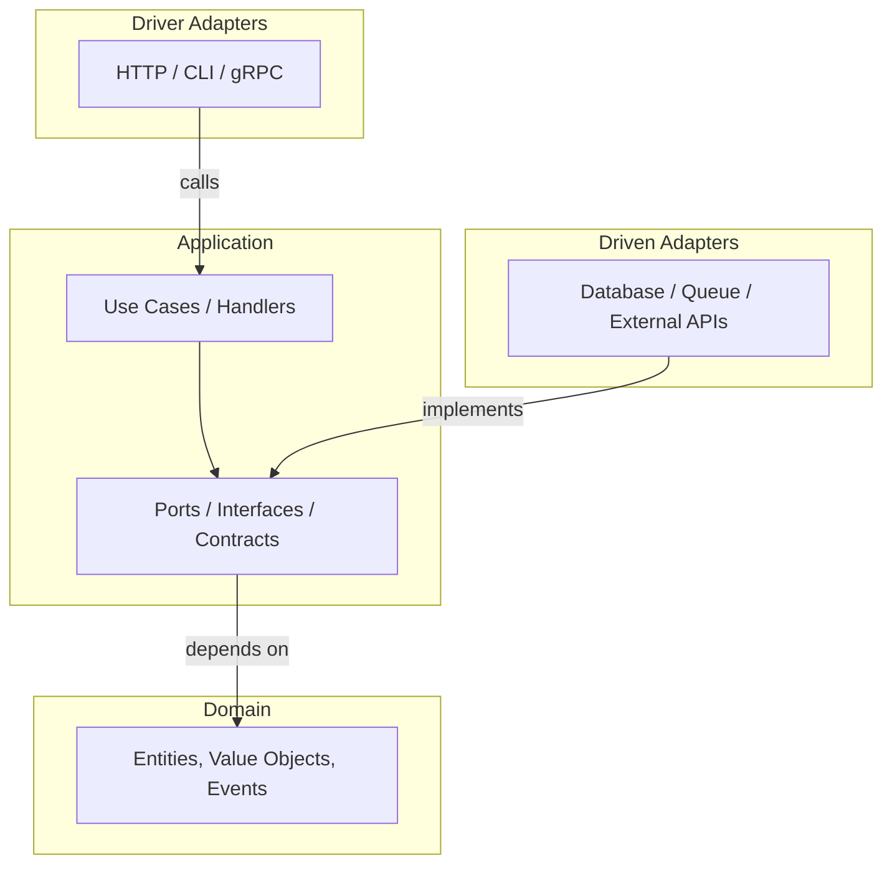

# Hexagonal Architecture (Ports & Adapters)

Language-agnostic guidelines for Clean Architecture and hexagonal ports/adapters. Apply these principles regardless of tech stack.

## When to Use (and When NOT to)

| Use When | Skip When |
|----------|-----------|
| Long-lived system (years of maintenance) | Prototype, MVP, throwaway code |
| Need to swap infrastructure (DB, broker) | Fixed infrastructure, unlikely to change |


## CRITICAL: The Dependency Rule

Dependencies point **inward only**. Outer layers depend on inner layers, never the reverse.

```
Infrastructure → Application → Application.Contracts + Domain <- Infrastructure
   (adapters)     (use cases)    (core)
```

**Violations to catch:**
- Domain importing database/HTTP libraries
- Controllers calling repositories directly (bypassing use cases)
- Entities depending on application services

**Design validation:** "Create your application to work without either a UI or a database" — Alistair Cockburn. If you can run your domain logic from tests with no infrastructure, your boundaries are correct.

## Ports and Adapters



- **Driver Port**: interface exposed TO the outside (use case boundary)
- **Driver Adapter**: entry point that calls the port (REST controller, CLI, message consumer)
- **Driven Port**: interface the domain NEEDS from outside (repository, gateway)
- **Driven Adapter**: infrastructure that implements the port (DB repo, HTTP client, queue publisher)

## Quick Decision Trees

### "Where does this code go?"

```
Where does it go?
├─ Pure business logic, no I/O           → Domain layer
├─ Orchestrates domain + has side effects → Application layer (use case)
├─ Talks to external systems              → Infrastructure (adapter)
├─ Defines HOW to interact (interface)    → Port (application or domain layer)
└─ Implements a port                      → Adapter (infrastructure layer)
```

## Key Concepts

| Concept | Purpose | Layer | Key Rule |
|---------|---------|-------|----------|
| **Port** (driven) | Abstraction the app NEEDS from outside | Application | Interface defined by the application |
| **Port** (driver) | Use case boundary exposed TO outside | Application | Entry point for external callers |
| **Adapter** (driven) | Infrastructure implementing a port | Infrastructure | Implements the port interface |
| **Adapter** (driver) | Entry point calling a port | Infrastructure | REST controller, CLI, consumer |
| **Use Case / Handler** | Application-level orchestration | Application | Coordinates domain + infra via ports |

## Anti-Patterns (CRITICAL)

| Anti-Pattern | Problem | Fix |
|--------------|---------|-----|
| **Leaking Infrastructure** | Domain/Application imports DB/HTTP libs | Inner layers have ZERO infrastructure deps |
| **Skipping Ports** | Controllers → Repositories directly | Always go through application layer via ports |
| **Circular Dependencies** | Outer layer referenced by inner layer | Dependencies point inward ONLY |
| **Fat Adapters** | Business logic inside controllers or repos | Adapters are thin — delegate to use cases |
| **Missing Port** | Concrete infra class used directly in app | Always define an interface (port) first |
| **Shared Infrastructure** | Multiple adapters coupled together | Each adapter is independent, implements its own port |

## Implementation Order

1. **Define Domain Layer** — Core business logic, no infrastructure dependencies
2. **Define Ports** — Interfaces for persistence, external services, messaging
3. **Implement Use Cases** — Application services coordinating domain via ports
4. **Add Driven Adapters** — Database, external APIs, queue implementations
5. **Add Driver Adapters** — HTTP controllers, CLI, message consumers

## Sources

- [The Clean Architecture](https://blog.cleancoder.com/uncle-bob/2012/08/13/the-clean-architecture.html) — Robert C. Martin (2012)
- [Hexagonal Architecture](https://alistair.cockburn.us/hexagonal-architecture/) — Alistair Cockburn (2005)
