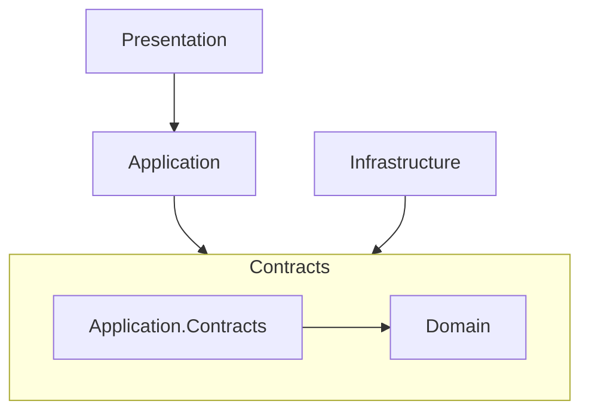

# Architecture Skill (.NET 9/10)

You are an expert in layered clean architecture for .NET 9/10. This skill defines the solution structure, layer responsibilities, and project references.

**RELATED SKILLS:**
- `dotnet-scaffold` — for creating new solutions
- `dotnet-feature` — for implementing features across layers
- `dotnet-code-style` — for code conventions

---

## Solution Structure

```
src/
  ProjectName.Startup                       → Entry point, Program.cs, wires DI and middleware only
  Presentation/
    ProjectName.Presentation.Api            → Controllers, endpoint routing, API Module
    ProjectName.Presentation.Consumers      → (OPTIONAL) Message consumers, consumer Module
  Application/
    ProjectName.Application                 → Use cases (MediatR handlers OR application services), validators, Module
    ProjectName.Application.Contracts       → Repository/service interfaces + shared DTOs
  Domain/
    ProjectName.Domain                      → Entities, value objects, domain services, enums
  Infrastructure/
    ProjectName.Infrastructure.Db           → EF Core DbContext, repositories, UoW, Module
    ProjectName.Infrastructure.Security     → (OPTIONAL) JWT, password hashing, auth-related services
    ProjectName.Infrastructure.Http         → (OPTIONAL) Typed HTTP clients, external API wrappers
    ProjectName.Infrastructure.Blob         → (OPTIONAL) File/blob storage (Azure Blob, S3, local disk)

tests/
  ProjectName.Domain.UnitTests              → (RECOMMENDED) see `dotnet-unit-testing`
  ProjectName.Application.UnitTests         → (RECOMMENDED) see `dotnet-unit-testing`
  ProjectName.IntegrationTests              → (RECOMMENDED) see `dotnet-integration-testing`

ProjectName.sln
docker-compose.yml                          → (OPTIONAL) Local dev dependencies
```

---

## Project References

```
Startup                  → Presentation.Api, Application, Infrastructure.Db
                         → (if consumers) Presentation.Consumers
                         → (if security) Infrastructure.Security
                         → (if http) Infrastructure.Http
                         → (if blob) Infrastructure.Blob
Presentation.Api         → Application, Application.Contracts
Presentation.Consumers   → Application, Application.Contracts          (OPTIONAL)
Application              → Application.Contracts, Domain
Application.Contracts    → Domain
Infrastructure.Db        → Application.Contracts
Infrastructure.Security  → Application.Contracts                       (OPTIONAL)
Infrastructure.Http      → Application.Contracts                       (OPTIONAL)
Infrastructure.Blob      → Application.Contracts                       (OPTIONAL)
```

**Key Rule:** Startup is the only project that references everything — it exists solely to wire things together. Presentation never references Infrastructure directly.

---

## Layer Responsibilities

| Layer | Owns |
|---|---|
| **Startup** | `Program.cs` only — calls each layer's `Module`, registers middleware pipeline |
| **Domain** | Entities, value objects, domain events, enums, domain exceptions |
| **Application.Contracts** | Repository interfaces, external service interfaces, shared DTOs |
| **Application** | Use cases — MediatR commands/queries/handlers + pipeline behaviours, **or** application services (see Dispatch Style) — validators, `Module` |
| **Infrastructure.Db** | DbContext, EF config, repository implementations, UoW, migrations, `Module` |
| **Infrastructure.Security** | (OPTIONAL) JWT token generation, password hashing, API key services, auth helpers |
| **Infrastructure.Http** | (OPTIONAL) Typed HTTP clients implementing interfaces from Application.Contracts |
| **Infrastructure.Blob** | (OPTIONAL) File/blob storage implementations (Azure Blob, S3, local disk) |
| **Presentation.Api** | Controllers, `Module` |
| **Presentation.Consumers** | (OPTIONAL) Message consumer classes, `Module` |

---

## Where Does Code Belong?

| Code Type | Layer | Example Path |
|-----------|-------|--------------|
| Entity | Domain | `Domain/Orders/Order.cs` |
| Value Object | Domain | `Domain/Orders/Money.cs` |
| Enum | Domain | `Domain/Orders/OrderStatus.cs` |
| Domain Exception | Domain | `Domain/Exceptions/OrderNotFoundException.cs` |
| Repository Interface | Application.Contracts | `Application.Contracts/Persistence/IOrderRepository.cs` |
| Service Interface | Application.Contracts | `Application.Contracts/Services/IJwtTokenService.cs` |
| DTO | Application.Contracts | `Application.Contracts/Dtos/OrderDto.cs` |
| Command/Query (MediatR) | Application | `Application/Orders/CreateOrder.cs` |
| Handler (MediatR) | Application | `Application/Orders/CreateOrder.cs` (same file) |
| Validator | Application | `Application/Orders/CreateOrder.cs` (same file) |
| Pipeline Behaviour (MediatR) | Application | `Application/Behaviours/ValidationBehaviour.cs` |
| Application Service interface (no MediatR) | Application | `Application/Orders/IOrderService.cs` |
| Application Service (no MediatR) | Application | `Application/Orders/OrderService.cs` |
| Request/response records (no MediatR) | Application | `Application/Orders/CreateOrderRequest.cs` |
| Unit tests | tests | `tests/ProjectName.Application.UnitTests/Orders/CreateOrderTests.cs` |
| Integration tests | tests | `tests/ProjectName.IntegrationTests/Orders/OrdersEndpointsTests.cs` |
| Repository Implementation | Infrastructure.Db | `Infrastructure.Db/Persistence/OrderRepository.cs` |
| Entity Configuration | Infrastructure.Db | `Infrastructure.Db/Configurations/OrderConfiguration.cs` |
| DbContext | Infrastructure.Db | `Infrastructure.Db/AppDbContext.cs` |
| UnitOfWork | Infrastructure.Db | `Infrastructure.Db/Persistence/UnitOfWork.cs` |
| Database Options | Infrastructure.Db | `Infrastructure.Db/Options/DatabaseOptions.cs` |
| JWT Token Service | Infrastructure.Security | `Infrastructure.Security/Services/JwtTokenService.cs` |
| Password Hasher | Infrastructure.Security | `Infrastructure.Security/Services/PasswordHasher.cs` |
| API Key Generator | Infrastructure.Security | `Infrastructure.Security/Services/ApiKeyGenerator.cs` |
| Security Options | Infrastructure.Security | `Infrastructure.Security/Options/JwtOptions.cs` |
| HTTP Client | Infrastructure.Http | `Infrastructure.Http/PaymentGatewayClient.cs` |
| File Storage Service | Infrastructure.Blob | `Infrastructure.Blob/Services/AzureBlobStorageService.cs` |
| Blob Options | Infrastructure.Blob | `Infrastructure.Blob/Options/BlobStorageOptions.cs` |
| Controller | Presentation.Api | `Presentation.Api/Controllers/Orders/v1/OrdersController.cs` |
| Auth Middleware | Presentation.Api | `Presentation.Api/Middleware/ExceptionHandlingMiddleware.cs` |
| Message Consumer | Presentation.Consumers | `Presentation.Consumers/Orders/OrderCreatedConsumer.cs` |

### Infrastructure Layer Boundaries

Each Infrastructure project has a strict scope. **One concern per project — no mixing.**

| Project | Scope | What Goes Here | What Does NOT Go Here |
|---------|-------|----------------|----------------------|
| **Infrastructure.Db** | Database access ONLY | DbContext, repositories, EF configurations, migrations, UnitOfWork, database options | JWT, password hashing, file storage, HTTP clients |
| **Infrastructure.Security** | Authentication & cryptography | JWT token generation, password hashing/verification, API key generation, security options | Database queries, HTTP clients, file storage |
| **Infrastructure.Http** | External HTTP APIs ONLY | Typed HTTP clients wrapping third-party APIs, retry policies, HTTP options | Database access, auth logic, file storage |
| **Infrastructure.Blob** | File/blob storage ONLY | Upload/download files, Azure Blob / S3 / local disk adapters, blob options | Database access, auth logic, HTTP clients |

**Rule:** If a service doesn't match the project's scope, create a new `Infrastructure.{Purpose}` project or put it in the appropriate existing one. Never dump unrelated services into Infrastructure.Db because it already exists.

---

## Dependency Direction



**Dependencies flow top-down:** Presentation depends on Application. Application depends on Application.Contracts and Domain. Infrastructure implements interfaces defined in Application.Contracts.

---

## Required .csproj Modifications

### Presentation.Api (MANDATORY)

Since Presentation.Api is a class library that uses ASP.NET Core controllers, it MUST include a FrameworkReference:

```xml
<Project Sdk="Microsoft.NET.Sdk">
  <ItemGroup>
    <FrameworkReference Include="Microsoft.AspNetCore.App" />
  </ItemGroup>
  <!-- ... rest of the csproj ... -->
</Project>
```

### Startup (IMPORTANT)

The Startup project should NOT have its own Microsoft.AspNetCore.OpenApi package — it gets it transitively from Presentation.Api. Remove any duplicate OpenApi package reference from Startup.csproj if present.

---

## Central Package Management (CPM)

All solutions use Central Package Management. Package versions are defined in `Directory.Packages.props` at the solution root.

### Adding a New Package

```bash
# Add package (no version needed - CPM handles it)
dotnet add src/Application/ProjectName.Application package SomePackage
```

Then add the version to `Directory.Packages.props`:

```xml
<PackageVersion Include="SomePackage" Version="1.0.0" />
```

### Solution Root Files

```
ProjectName/
├── Directory.Packages.props    # Central package versions
├── Directory.Build.props       # Shared build properties (TFM, Nullable, etc.)
├── ProjectName.sln
└── src/
```

---

## Module Pattern

Each layer exposes a single `Module.cs` with an `IServiceCollection` extension method:

```csharp
// Pattern for each layer
public static class Module
{
    public static IServiceCollection Add{LayerName}(
        this IServiceCollection services,
        IConfiguration configuration)  // Only if layer needs config
    {
        // Register services for this layer
        return services;
    }
}
```

**Startup calls all modules:**

```csharp
builder.Services
    .AddApplication()
    .AddInfrastructure(builder.Configuration)
    .AddApi(builder.Configuration);
```

---

## Package Versions by .NET Version

| Package | .NET 9 | .NET 10 |
|---------|--------|---------|
| EF Core | 9.0.0 | 10.0.0 |
| MediatR (only if the solution uses MediatR) | 14.1.0 | 14.1.0 |
| FluentValidation | 12.1.1 | 12.1.1 |
| EFCore.NamingConventions | 9.0.0 | 10.0.0 |
| Scalar.AspNetCore | 1.2.3 | 2.0.0 |
| Microsoft.Extensions.* | 9.0.0 | 10.0.0 |

**Note:** EFCore.NamingConventions is only needed for PostgreSQL (converts PascalCase to snake_case).

**MediatR licensing:** MediatR 13 and later are commercially licensed and expect a license key (a free community license exists for smaller organizations). 12.x is the last Apache-2.0 line. Before adding MediatR to a solution, confirm which line the team is licensed for; never upgrade an existing 12.x reference to 13+ silently.

---

## Dispatch Style — MediatR or Application Services

Both styles are supported. **Always match what the solution already does — never introduce MediatR into a solution that doesn't use it, and never rip it out of one that does.**

Detect the style before writing Application code:

1. Search `Directory.Packages.props` / `*.csproj` for a `MediatR` package reference.
2. Search the Application project for `IRequestHandler<` or `ISender`.
3. Either found → **MediatR style**: static operation class with `Command`/`Query` + `Validator` + `Handler`; controllers inject `ISender`. Follow `dotnet-mediatr`.
4. Neither found → **Application-service style**: one `public interface I<Aggregate>Service` + `internal sealed class <Aggregate>Service` per aggregate in `Application/<Aggregate>/`; request/response records next to it; controllers inject the interface; validators are injected as `IValidator<TRequest>` and called with `ValidateAndThrowAsync` at the start of each service method. Templates: `dotnet-feature` → `references/application-services.md`.
5. Mixed or unclear (e.g. MediatR referenced but unused) → ask the user.

For **new** solutions, `dotnet-scaffold` asks which style to use.

---

## Target Framework & Existing Projects

New solutions target **.NET 9 or .NET 10**. Existing solutions often target older frameworks — never upgrade a target framework or a package major version as a side effect of feature work.

Before writing code in an existing solution:

1. Read `<TargetFramework>` / `<TargetFrameworks>` from the `.csproj` files or `Directory.Build.props`, plus `global.json` for the SDK and `<LangVersion>` if set.
2. Keep package versions on the major line the solution already uses (EF Core major = .NET major; `Microsoft.Extensions.*` major = .NET major).
3. Only use APIs and C# features available for that target:

| Target | Not available — avoid |
|--------|----------------------|
| .NET 9 | C# 14 features (`field` keyword, extension members); .NET 10 / EF Core 10 APIs |
| .NET 8 | Everything above, plus C# 13 (`params` collections, `System.Threading.Lock`), built-in `AddOpenApi()` (use Swashbuckle as the project does), `MapStaticAssets` |
| .NET 6/7 | Everything above, plus keyed services (`[FromKeyedServices]`), `TimeProvider`, C# 12 collection expressions, EF Core 8 complex types and primitive collections; on .NET 6 also no `ExecuteUpdate`/`ExecuteDelete` (EF Core 7+) |
| .NET Framework 4.x | Treat as a different stack: EF6 instead of EF Core, `System.Web`/OWIN or classic ASP.NET MVC/Web API instead of ASP.NET Core, `web.config`/`app.config` instead of `appsettings.json`. Follow the existing project's patterns; apply only the language-agnostic parts of these skills (layering, naming, clean code). |

4. If a requested change genuinely needs a newer framework, say so and propose the upgrade as a separate step — don't do it implicitly.

---

## Key Architecture Principles

1. **Domain is the core** — no external dependencies, pure business logic
2. **Application orchestrates** — coordinates domain operations, defines use cases
3. **Infrastructure implements** — databases, HTTP clients, external services
4. **Presentation receives** — HTTP requests, messages, scheduled triggers
5. **Startup only wires** — no business logic, just dependency injection

---

## Code Style Requirements

All generated code MUST follow `dotnet-code-style` conventions:
- File-scoped namespaces (`namespace Foo;`)
- `using` directives inside namespace, System usings first
- No primary constructors — use traditional constructors
- No expression-bodied methods — use block bodies `{ }`
- Explicit types (no `var`)
- Private fields use `_` prefix (no `this.` prefix)
- No `this.` prefix for member access
