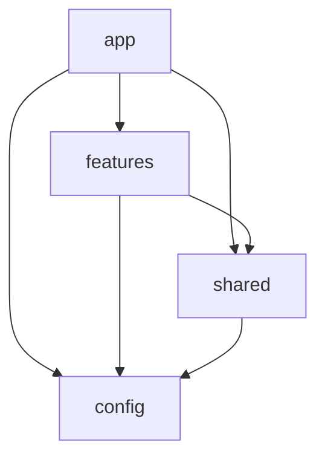

# Architecture Skill (React + TypeScript + Vite)

You organize React applications around **features** (business capabilities) and **shared** (cross-cutting reuse). The app shell wires routing, providers, and global layout only.

**RELATED SKILLS:**
- `react-code-style` — naming, imports, and file conventions
- `react-typescript` — strict typing and runtime validation
- `react-configuration` — centralized `appConfig` and env handling
- `react-api-client` — axios clients, interceptors, auth, errors
- `react-data-fetching` — TanStack Query hooks, keys, mutations
- `react-unit-testing` — Vitest + Testing Library; tests mirror `src/` under `tests/`
- `react-scaffold` — bootstrap new apps from reference React template tooling
- `react-feature` — implement a feature end-to-end across layers

**Standard stack (when implementing, prefer these unless the repo differs):**
- **Routing:** TanStack Router
- **Server state:** TanStack Query
- **HTTP:** axios (via `shared/api`)
- **Forms:** React Hook Form + Zod
- **UI:** Tailwind CSS; shadcn/ui components live under `shared/components/ui` when present
- **Auth:** backend-driven — adapt to the API’s auth model (cookies, bearer token, OIDC, etc.)

---

## Solution Structure

```
src/
  app/                          → Shell only: router, providers, root layout, global styles
    routes/                     → TanStack Router route tree (file-based or route modules)
    providers/                  → QueryClientProvider, theme, auth wrapper (composition root)
    App.tsx                     → Root component (or main.tsx entry)
  config/                       → appConfig, env schema (see react-configuration)
  features/
    <feature-name>/             → One folder per business capability (orders, users, auth, …)
      api/                      → Feature API functions + query/mutation keys
      components/               → Feature-private UI
      hooks/                    → Feature-private hooks
      pages/                    → Route-facing page components
      types/                    → Feature-owned types and Zod schemas
      index.ts                  → Public API — only exports other modules may import
  shared/
    api/                        → axios instance, interceptors, base error types
    components/                 → Reusable presentational components
      ui/                       → (OPTIONAL) shadcn primitives — Button, Input, Dialog, …
    hooks/                      → Reusable hooks with no feature coupling
    lib/                        → Pure utilities (cn, formatters, constants)
    types/                      → Truly cross-feature types only
    utils/                      → Small helpers (date, string) when not worth a lib/ module

index.html
vite.config.ts
tailwind.config.ts              → (when using Tailwind)
components.json                 → (OPTIONAL) shadcn config

tests/                          → Unit tests mirroring src/ (see react-unit-testing)
  vitest.setup.ts
  testUtils/
  __mocks__/
  features/                     → mirrors src/features/
  shared/                       → mirrors src/shared/
```

**Key rule:** `app/` and `config/` orchestrate; **features own product logic**; **shared** has no knowledge of any single feature.

---

## Dependency Direction



| From | May import | Must NOT import |
|------|------------|-----------------|
| `app/` | `features/*` (via public `index.ts`), `shared/`, `config/` | Feature internals bypassing `index.ts` |
| `features/<a>/` | `shared/`, `config/`, same feature internally | `features/<b>/` internals (other features) |
| `shared/` | `config/`, other `shared/` | Any `features/` path |
| `config/` | — | `features/`, `shared/`, `app/` |

**Cross-feature needs:** expose through the owning feature’s `index.ts`, lift to `shared/`, or compose in `app/` (routes/layout). Never import `features/orders/components/OrderRow.tsx` from `features/users/`.

---

## Layer Responsibilities

| Area | Owns | Does NOT own |
|------|------|----------------|
| **app/** | Route tree, provider composition, root layout, global error boundary shell | Feature business rules, API shapes, form schemas |
| **config/** | Validated `appConfig`, env schema | Feature types, UI |
| **features/** | Pages, feature UI, feature hooks, feature API wrappers, feature types | Generic buttons, axios setup, app-wide routing |
| **shared/** | axios client, generic hooks, design-system primitives, cross-feature utilities | Feature-specific workflows or copy |

---

## Where Does Code Belong?

| Code type | Location | Example path |
|-----------|----------|--------------|
| Route definition | `app/routes/` | `app/routes/orders.route.tsx` |
| Root providers | `app/providers/` | `app/providers/AppProviders.tsx` |
| Page (route target) | `features/*/pages/` | `features/orders/pages/OrdersPage.tsx` |
| Feature-only component | `features/*/components/` | `features/orders/components/OrderTable.tsx` |
| Feature hook | `features/*/hooks/` | `features/orders/hooks/useOrderFilters.ts` |
| Query key + fetcher | `features/*/api/` | `features/orders/api/orders.api.ts` |
| Feature types / Zod schema | `features/*/types/` | `features/orders/types/order.schema.ts` |
| axios instance, interceptors | `shared/api/` | `shared/api/httpClient.ts` |
| Generic UI primitive | `shared/components/` or `shared/components/ui/` | `shared/components/ui/button.tsx` |
| Generic hook | `shared/hooks/` | `shared/hooks/useMediaQuery.ts` |
| Env / API base URL | `config/` | `config/config.ts` |
| Auth adapter (BE-specific) | `features/auth/` or `shared/` if reused | `features/auth/api/auth.api.ts` |
| Unit / component test | `tests/` mirroring `src/` | `tests/features/orders/components/OrderTable.test.tsx` |

---

## Feature Module Pattern

Each feature exposes a **narrow public API** through `index.ts`:

```ts
// features/orders/index.ts
export { OrdersPage } from "./pages/OrdersPage";
export { OrderDetailsPage } from "./pages/OrderDetailsPage";
export { orderKeys } from "./api/orders.keys";
```

- Export **pages**, **route components**, and symbols other features or `app/` truly need.
- Keep `components/`, `hooks/`, and `api/` implementation details private unless exported intentionally.
- Prefer **named exports** in the public API.

---

## App Shell Pattern

### Providers (`app/providers/AppProviders.tsx`)

Compose global clients once:

```tsx
import { QueryClient, QueryClientProvider } from "@tanstack/react-query";
import { type ReactNode, useState } from "react";

type AppProvidersProps = {
  children: ReactNode;
};

export function AppProviders({ children }: AppProvidersProps) {
  const [queryClient] = useState(() => new QueryClient());

  return (
    <QueryClientProvider client={queryClient}>
      {children}
    </QueryClientProvider>
  );
}
```

Add auth/theme providers here when the backend or design requires them. Do not register feature-specific state at the root unless multiple routes need it.

### Routing (`app/routes/`)

- TanStack Router owns the route tree under `app/routes/`.
- Route files **import page components from `features/<name>`** via `index.ts`, not deep paths.
- Route loaders may call `shared/api` or feature `api/` functions; keep loaders thin.

### Pages vs components

| | `pages/` | `components/` |
|---|----------|----------------|
| Used by | Router | Feature UI |
| Contains | Layout sections, data wiring, composition | Presentational or feature-specific pieces |
| May use | Feature hooks, TanStack Query, forms | Props; hooks only when local UI state |

---

## Data Access Boundaries

| Concern | Location |
|---------|----------|
| axios instance, auth header injection | `shared/api/httpClient.ts` |
| Base URL from config | `shared/api` reads `appConfig` (see `react-configuration`) |
| Endpoint functions | `features/<name>/api/*.api.ts` |
| Query keys | `features/<name>/api/*.keys.ts` |
| `useQuery` / `useMutation` hooks | `features/<name>/hooks/` or colocated next to pages |

**Rule:** Features never create their own axios instance. They use the shared client.

---

## UI (Tailwind / shadcn)

- **Tailwind** is the default styling approach for layout and spacing in features and shared.
- **shadcn/ui** components, when used, live under `shared/components/ui/` and are imported by features as shared primitives.
- Features may compose shadcn primitives; avoid copying generated shadcn files into feature folders.
- Custom brand components that are reused across features belong in `shared/components/`, not duplicated per feature.

---

## Auth (backend-driven)

Do not hardcode one auth vendor in architecture. Place auth in:

- **`features/auth/`** when login/session flows are product-specific, or
- **`shared/`** when the same auth client is reused identically everywhere.

The app shell (`app/providers/`) wires whatever session/token mechanism the **backend** exposes (cookie session, bearer token refresh, external IdP redirect, etc.). Route guards live in TanStack Router (`beforeLoad`, redirects) using that mechanism.

---

## Path Aliases

Use a single alias (typically `@/`) mapped to `src/`:

```ts
import { appConfig } from "@/config/config";
import { httpClient } from "@/shared/api/httpClient";
import { OrdersPage } from "@/features/orders";
```

Never use deep relative imports that cross from one feature into another (`../../users/...`).

---

## Key Architecture Principles

1. **Features are vertical slices** — each encapsulates UI + data + types for one capability.
2. **Shared is generic** — no imports from `features/`.
3. **App shell only wires** — routing and providers, no business rules.
4. **Config is the only env gateway** — see `react-configuration`.
5. **Public feature APIs are explicit** — `index.ts` is the contract.
6. **Server state stays in features** — TanStack Query hooks live with the feature that owns the data.

---

## Code Style Requirements

All generated code MUST follow `react-code-style` and `react-typescript` conventions.

---

## Gotchas

- Importing another feature’s internal file breaks boundaries — use `index.ts`, `shared/`, or `app/` composition.
- Putting axios or env reads in feature components couples UI to infrastructure — use `shared/api` and `appConfig`.
- Growing `shared/` with feature-specific names (`shared/components/OrderTable.tsx`) — move it back into the feature.
- Default-exporting pages makes route lazy-loading and refactors harder — prefer named exports in features.
