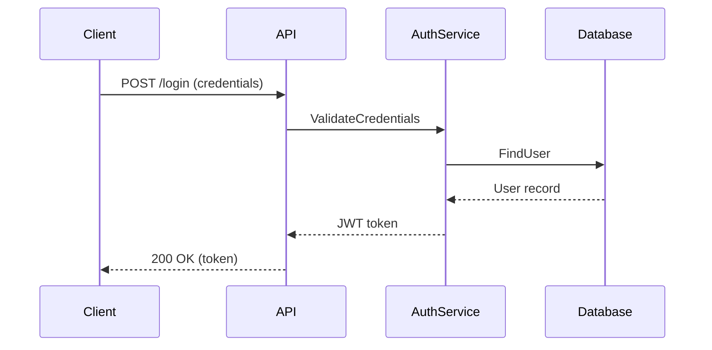

# Mermaid Diagram Generator

## Description

Generates diagrams using Mermaid syntax that render beautifully in GitHub, VS Code, and most documentation platforms. Supports flowcharts, sequence diagrams, class diagrams, entity relationship diagrams, state diagrams, C4 architecture diagrams, and more.

## When to Use

- Generating Mermaid diagrams for documentation
- Creating flowcharts, sequence diagrams, or class diagrams
- Adding entity relationship diagrams to project docs
- Building state diagrams or C4 architecture diagrams
- Producing visuals that render natively in GitHub Markdown

## Usage

Activate this skill and describe the diagram you need. Specify:

- The type of diagram (flowchart, sequence, class, ER, state, C4)
- Components, relationships, and flow direction
- Any styling or grouping requirements

## Example

**Input:** "Create a sequence diagram showing user authentication flow"

**Output:**

## Requirements

- No external tools required
- Renders in GitHub, VS Code, GitLab, Notion, and most Markdown viewers
