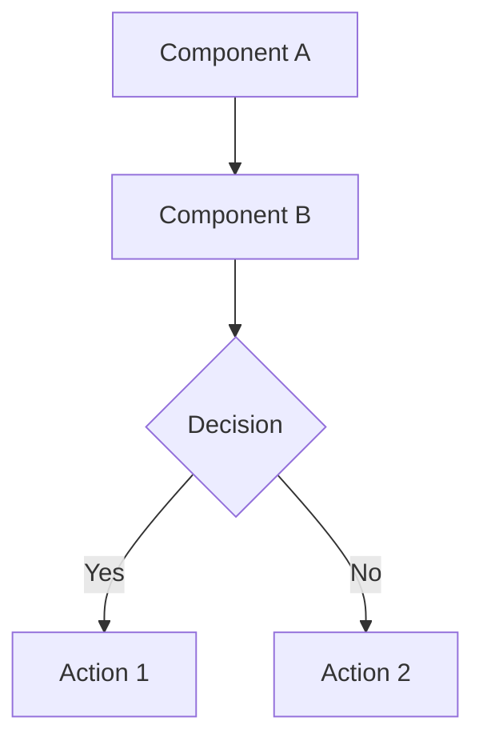
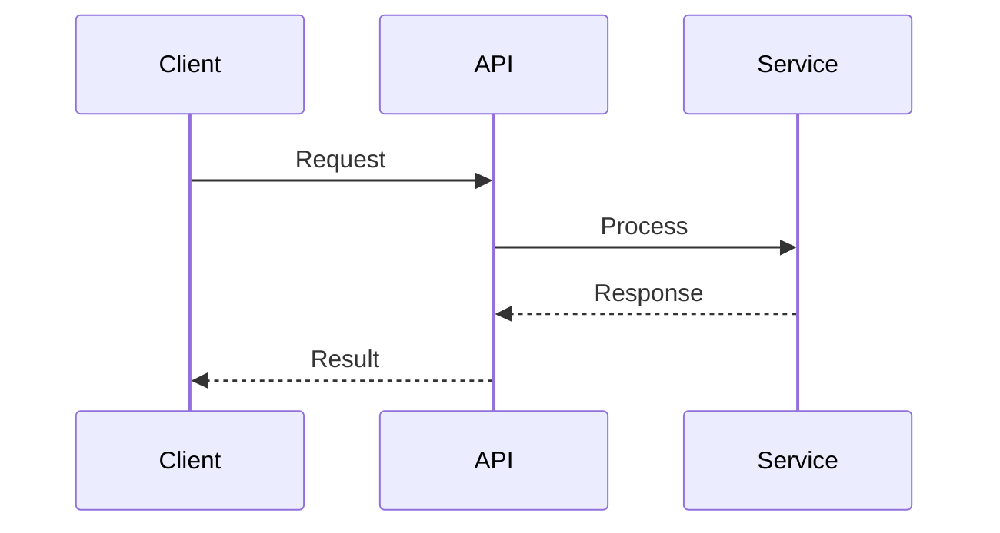
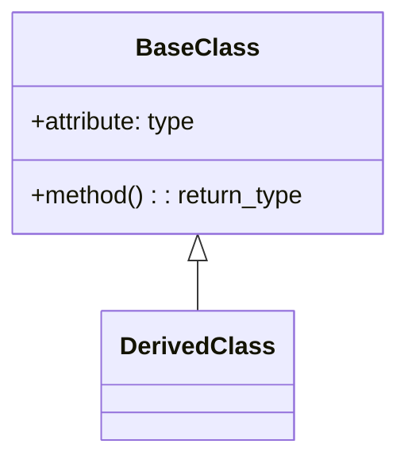
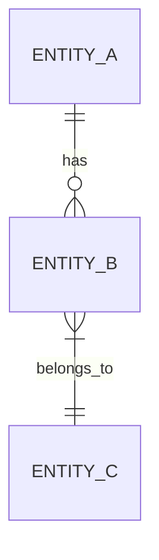
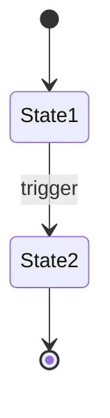
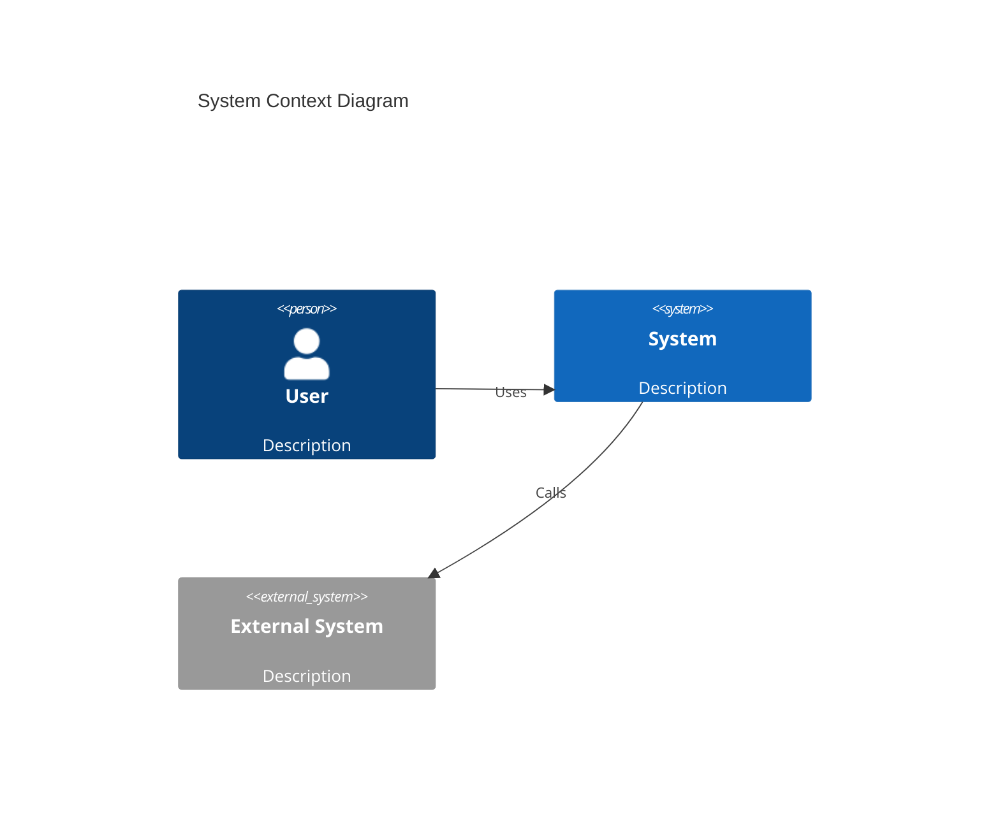
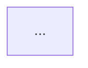
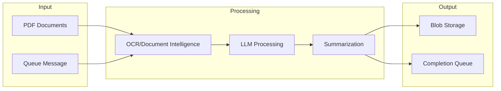
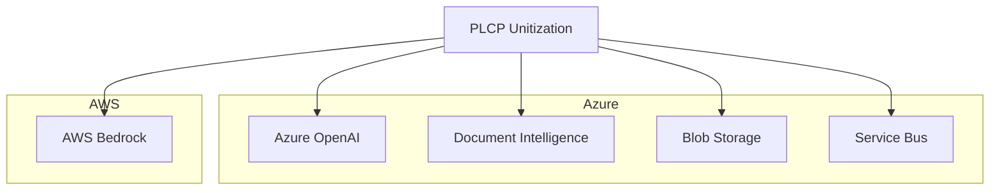

# Mermaid Diagram Generator

Generate diagrams using Mermaid syntax that render beautifully in GitHub, VS Code, and most documentation platforms.

## Supported Diagram Types

### Flowchart / Architecture


### Sequence Diagram


### Class Diagram


### Entity Relationship


### State Diagram


### C4 Context Diagram


## Generation Guidelines

1. **Choose the right diagram type** for the content:
   - Architecture/flow → `flowchart`
   - Interactions over time → `sequenceDiagram`
   - Object relationships → `classDiagram`
   - Data models → `erDiagram`
   - Lifecycle/state → `stateDiagram-v2`
   - System boundaries → `C4Context` / `C4Container`

2. **Use clear, descriptive labels** — Avoid abbreviations unless widely known

3. **Direction matters**:
   - `TD` (top-down) for hierarchies
   - `LR` (left-right) for processes/flows
   - `TB` (top-bottom) same as TD

4. **Style for clarity**:
   ```mermaid
   flowchart TD
       classDef service fill:#f9f,stroke:#333
       classDef database fill:#bbf,stroke:#333
       A[Service]:::service --> B[(Database)]:::database
   ```

5. **Keep it readable** — Break complex diagrams into multiple focused diagrams

## Output Format

Always wrap Mermaid code in a fenced code block with `mermaid` language identifier:

````markdown

````

## PLCP-Specific Patterns

For the PLCP Unitization project, common patterns include:

### Pipeline Flow


### Service Integration

