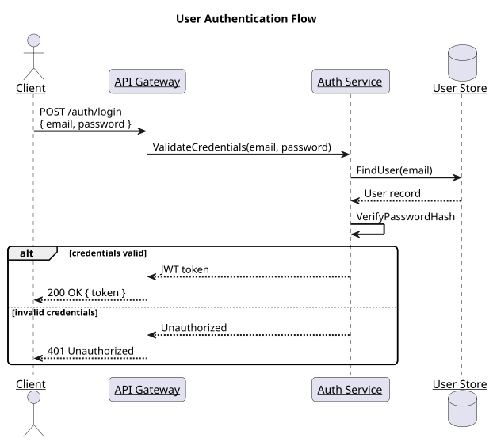
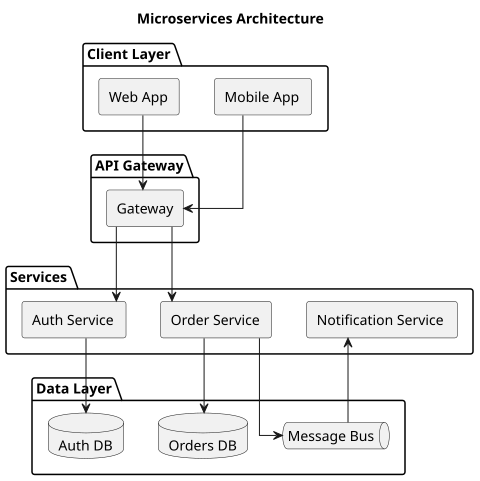
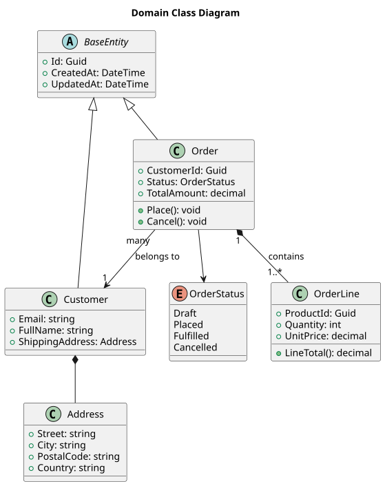
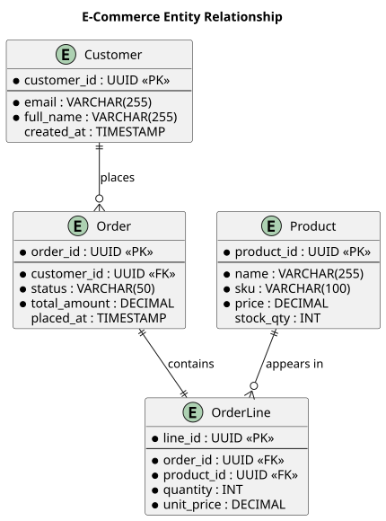
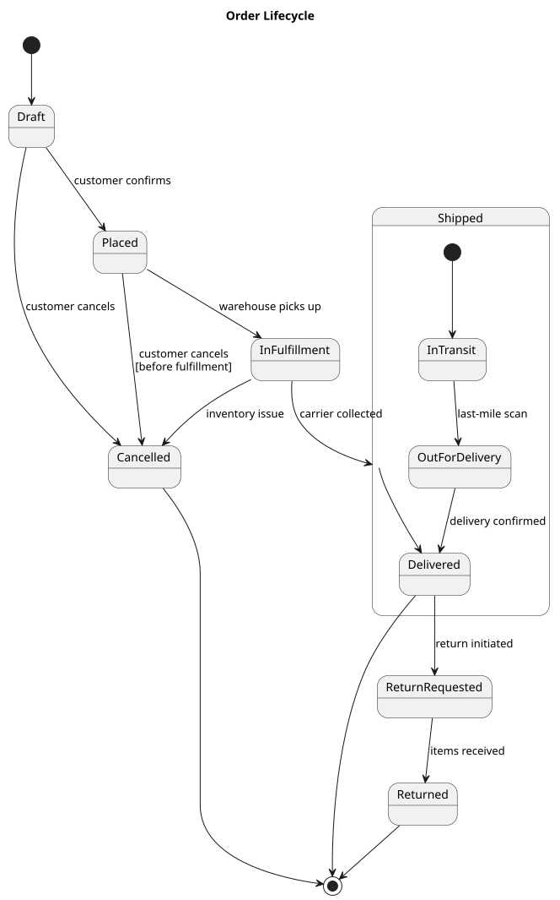
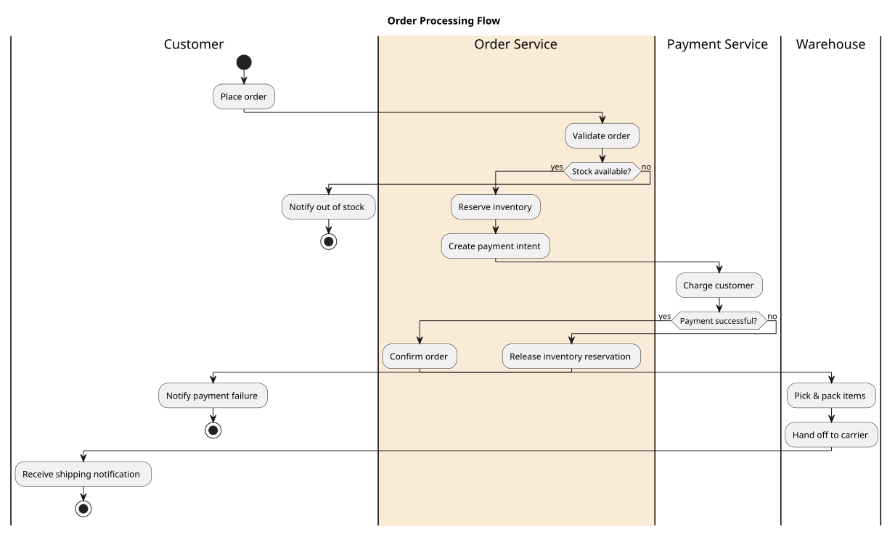
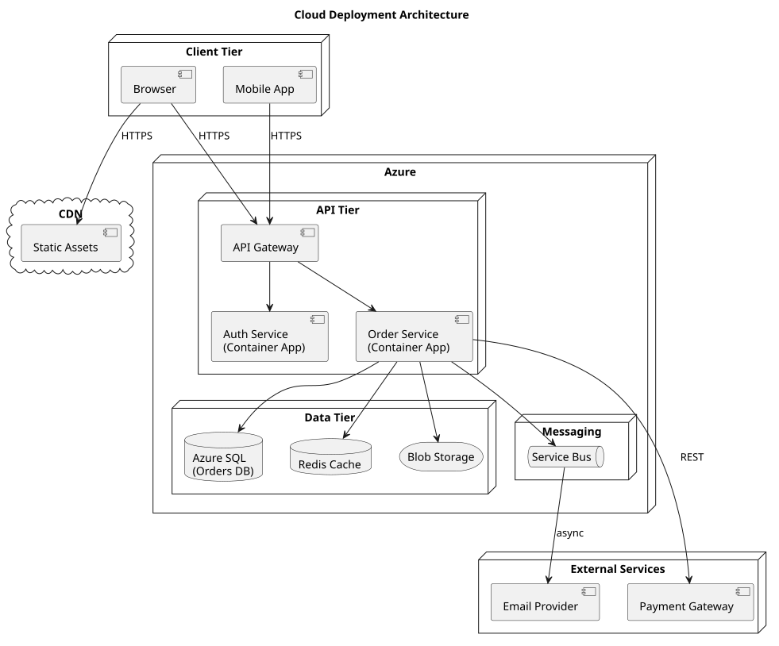
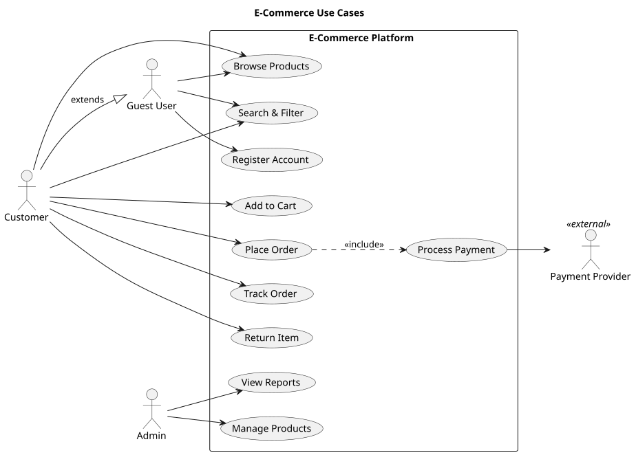
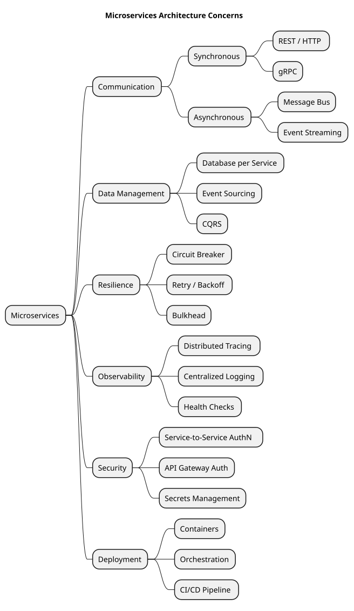

# PlantUML Diagram Generator

## Description

Generates diagrams using PlantUML syntax and renders them as SVG files. Because PlantUML does not render natively in GitHub or Bitbucket markdown, diagrams are maintained as `.puml` source files committed alongside their generated `.svg` output, which is then referenced from markdown.

## When to Use

- Generating sequence, component, class, or ER diagrams for documentation
- Creating architecture or deployment diagrams that need precise layout control
- Adding use case diagrams, state diagrams, activity diagrams with swimlanes, or mindmaps
- Producing visuals that display reliably in GitHub, Bitbucket, and any markdown viewer

## Usage

Activate this skill and describe the diagram you need. Specify:

- The type of diagram (sequence, class, ER, state, deployment, use case, activity, mindmap, etc.)
- Components, relationships, and flow direction
- Any grouping or highlighting requirements

## Example

**Input:** "Create a sequence diagram showing user authentication flow"

**Output:** `auth-flow.puml` source file and `auth-flow.svg` generated from it. The following line is added to your documentation markdown to display the diagram:

```markdown

```

*(The SVG reference above is intentionally a code snippet — the actual rendered samples are in the gallery below.)*

## Requirements

One of the following is required to generate SVG files:

- **plantuml CLI** — `brew install plantuml` (macOS), or download from [plantuml.com](https://plantuml.com/download)
- **Docker** — used to run `plantuml/plantuml` image (no local install needed)

If neither is available, SVG files cannot be generated and diagrams will not render correctly when referenced from markdown.

---

## Sample Diagrams

### Sequence — [source](samples/sequence.puml)



### Component / Architecture — [source](samples/architecture.puml)



### Class — [source](samples/class.puml)



### Entity Relationship — [source](samples/er.puml)



### State — [source](samples/state.puml)



### Activity with Swimlanes *(PlantUML only)* — [source](samples/activity-swimlanes.puml)



### Deployment *(PlantUML only)* — [source](samples/deployment.puml)



### Use Case *(PlantUML only)* — [source](samples/usecase.puml)



### Mindmap *(PlantUML only)* — [source](samples/mindmap.puml)


