# PlantUML Diagram Generator

Generate diagrams as `.puml` source files, render to `.svg`, and reference the SVG from markdown. PlantUML does not render natively in GitHub or Bitbucket — the SVG workflow is required.

## Prerequisites

Check in order before generating any diagram:

1. **Local plantuml** — run `plantuml -version`. If it succeeds, use:
   ```bash
   plantuml -tsvg <file>.puml
   ```
2. **Docker** — if plantuml is not installed locally, use:
   ```bash
   docker run --rm -v "$(pwd)":/data plantuml/plantuml -tsvg /data/<file>.puml
   ```
3. **Neither available** — stop and tell the user that either `plantuml` (e.g. `brew install plantuml`) or Docker is a prerequisite before proceeding.

## File Placement

Diagrams belong alongside the document that references them. The default convention is a **sibling folder named after the markdown file**:

```
docs/adrs/0042_event_sourcing.md          ← the document
docs/adrs/0042_event_sourcing/            ← diagram folder (same name, no extension)
    event_flow.puml
    event_flow.svg
```

Referenced from the markdown file as:
```markdown

```

**Placement rules (in priority order):**

1. **Project CLAUDE.md or in-context instructions** — if the project specifies a diagrams location, use that path exactly.
2. **Known document context** — if you know which markdown file will reference the diagram, create the sibling folder as shown above.
3. **No document context** — default to `docs/diagrams/`.

## Workflow

1. Determine the correct placement using the rules above
2. Write diagram source as `<name>.puml` in that folder
3. Generate SVG using the appropriate command above
4. Commit both `.puml` and `.svg`
5. Reference in the markdown file: ``

## Choosing the Right Diagram Type

| Goal | Diagram type |
|---|---|
| Interactions over time | sequence |
| Object structure & inheritance | class |
| Database schema | entity-relationship |
| Lifecycle / state transitions | state |
| Component structure & dependencies | component / architecture |
| Process flow with actor lanes | activity with swimlanes |
| Infrastructure & hosting topology | deployment |
| System scope & actor goals | use case |
| Hierarchical structure / brainstorming | mindmap |
| Signal timing, hardware/protocol | timing |
| Project schedule | Gantt |
| Task decomposition | WBS |
| UI wireframes | Salt |
| Network topology | nwdiag |
| Enterprise architecture layers | Archimate |
| Business process flows | BPMN |

## Diagram Syntax

### Sequence
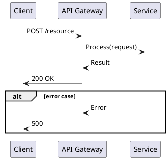

### Component / Architecture
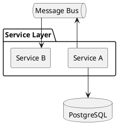

### Class
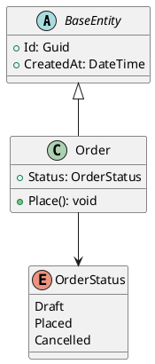

### Entity Relationship
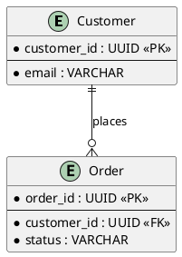

### State
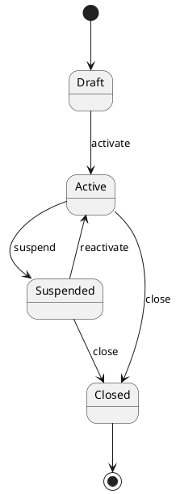

### Activity with Swimlanes
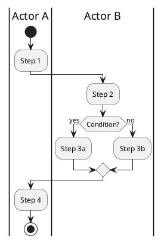

### Deployment
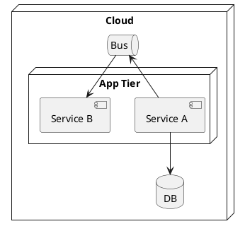

### Use Case
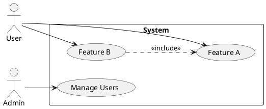

### Mindmap
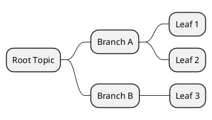

## Styling

Use PlantUML defaults. To draw attention to a specific element, use a `note` or apply a background colour to that element only — avoid broad `skinparam` overrides that change the overall look.

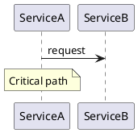

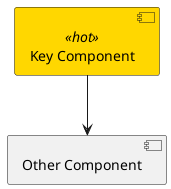

## Output

Always produce two files per diagram:

- `<name>.puml` — source, kept for future edits
- `<name>.svg` — generated output, committed alongside the source

Reference in markdown:
```markdown

```

Place both files in the same directory as the markdown file referencing them, or in a dedicated `diagrams/` subdirectory.
