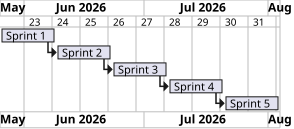

# Eval: Gantt Sprint Plan

Tests that the skill generates a Gantt diagram and correctly embeds it into an existing markdown document.

## Setup

Copy `fixture.md` to a scratch location that will act as the target document:

```bash
cp evals/gantt-sprint-plan/fixture.md scratch/sprint-plan.md
```

---

## Running the Eval

### Claude Code

Reference the skill file directly in your prompt:

```
Use @skills/development/common-plantuml-diagram/SKILL.md as skill to add a plantuml diagram
to scratch/sprint-plan.md. I want this to be a Gantt type of diagram showing 5 steps one
preceding another, start date 2026-05-26 and every activity representing a sprint that is two weeks.
```

### GitHub Copilot CLI

Install the skill first (one-time), then activate it for the session:

```bash
copilot skill install common-plantuml-diagram@awesome-agents
copilot chat --skill common-plantuml-diagram
```

Then issue the prompt:

```
Add a plantuml diagram to scratch/sprint-plan.md. I want this to be a Gantt type of diagram
showing 5 steps one preceding another, start date 2026-05-26 and every activity representing
a sprint that is two weeks.
```

### Codex CLI

Pass the skill as an instruction at runtime:

```bash
codex --instructions .codex/skills/common-plantuml-diagram.md \
  "Add a plantuml diagram to scratch/sprint-plan.md. I want this to be a Gantt type of diagram
   showing 5 steps one preceding another, start date 2026-05-26 and every activity representing
   a sprint that is two weeks."
```

---

## Expected Outputs

After the agent completes, verify all of the following:

### Files created
- [ ] `scratch/sprint-plan/` sibling folder exists (named after the markdown file, no extension)
- [ ] `scratch/sprint-plan/<name>.puml` exists
- [ ] `scratch/sprint-plan/<name>.svg` exists

### Diagram correctness — inspect the `.puml`
- [ ] Starts with `@startgantt` and ends with `@endgantt`
- [ ] Contains exactly 5 task definitions (lines matching `[Sprint N] lasts`)
- [ ] Each task duration is `14 days` (or `2 weeks`)
- [ ] Tasks are sequential: each starts at the previous task's end
- [ ] Start date is `2026-05-26`

### Markdown updated
- [ ] `scratch/sprint-plan.md` contains a `` image reference
- [ ] Original content of `fixture.md` is preserved above the new section

### SVG rendered
- [ ] `<name>.svg` is non-empty (plantuml ran successfully, not an error diagram)
- [ ] Visual output matches the reference diagram below

## Reference Diagram

Expected visual output ([source](expected.puml)):


