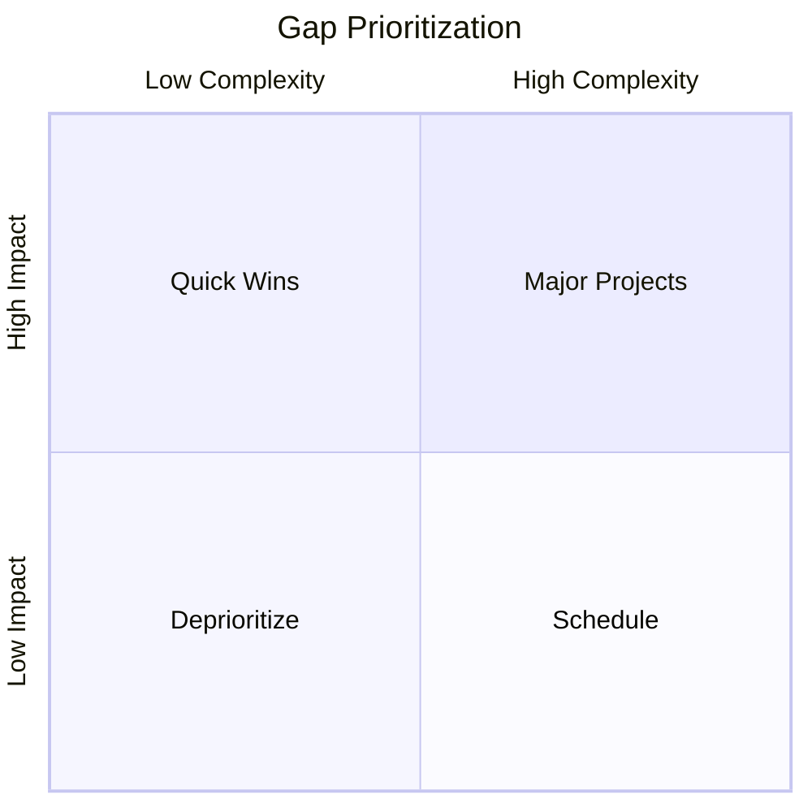

# Gap & Impact Analysis

## Overview

Compare where a system or process is today (as-is / current state) against where it needs to be
(to-be / future state), identify and classify every gap between the two, assess the impact of closing
those gaps across multiple dimensions, and recommend a prioritized remediation path.

Use this skill when the task is to model current vs future state, find and classify gaps, assess the
impact of a change, or prioritize remediation. The deliverable is analysis and recommendation, not the
implementation of the change itself.

Keep the work grounded in verified facts. The current state must reflect how things actually work today,
validated with people who do the work, not assumptions or aspirations.

## Inputs

Gather the minimum context before analysing:

- The change, initiative, or target the future state is driven by
- Scope boundary — which systems, processes, teams, or data are in scope and which are explicitly out
- A description of the current state (from interviews, observation, or existing documentation)
- A description of the desired future state (from a vision, requirements, or design)
- Constraints — timeline, budget, mandated platforms, dependencies

When the current state must be reconstructed from existing documents, use the
**requirements-source-ingestion** skill first to extract and normalize that material, then return here.

## Workflow

1. **Confirm scope and the future-state driver.** State in one sentence what is changing and why, and
   list what is in scope and out of scope. Do not start modelling until the boundary is agreed.
2. **Model the as-is state.** Describe how each in-scope area works today — steps, systems, data, roles,
   and known pain points. Keep it factual and validated.
3. **Model the to-be state.** Describe the target for each area. Each to-be statement must be specific
   enough that a gap against it is measurable.
4. **Build the as-is/to-be comparison.** For each aspect, place current and future state side by side
   (see the comparison table below). The delta between the two columns is the gap.
5. **Identify and classify gaps.** Write each gap into the gap register (below), assign a unique ID, and
   classify it by dimension (Process / System / People / Data, plus optional Governance).
6. **Assess impact.** For each gap or for the change as a whole, fill the impact matrix across all
   dimensions and rate severity. Write the narrative impact assessment.
7. **Prioritize.** Score each gap on impact x complexity and place it on the prioritization matrix.
8. **Recommend remediation.** For each gap, state the approach (build / buy / configure / process change /
   training / decommission), an owner, and dependencies. Give an overall recommendation.
9. **Trace.** Where gaps map to known requirements, link them using the
   **requirements-traceability-matrix** skill so remediation stays connected to requirements.
10. **Check against the Gotchas** before returning.

## As-Is / To-Be Comparison

One row per aspect. The `Gap` column is the delta; the `Action required` column previews remediation.

| Aspect | Current state (As-Is) | Future state (To-Be) | Gap | Action required |
|---|---|---|---|---|
| Order intake | Phone and email, re-keyed by hand | Self-serve web form, validated at entry | No digital channel; manual re-keying | Build intake form |
| Approval | Single approver, no audit trail | Two-step approval, logged | Missing second step and audit log | Configure workflow |

Pair this with two diagrams when a process is involved: an **as-is** flow with pain points annotated and
a **to-be** flow showing the improved path.

## Gap Register

The gap register is the core deliverable. Produce it as a **Markdown table** committed to the repo **and**
a parallel **`.csv`** with the same columns (Excel-openable and git-diffable). Do not produce `.xlsx`.

Columns:

| Column | Description |
|---|---|
| Gap ID | Unique identifier (GAP-001, GAP-002, ...) |
| Dimension | Process / System / People / Data / Governance |
| Area | The specific function or component affected |
| Current state | How it works today |
| Future state | The desired target |
| Gap description | What is missing or must change |
| Impact | High / Medium / Low — consequence of not closing the gap |
| Complexity | High / Medium / Low — difficulty of closing it |
| Priority | Derived from impact x complexity |
| Remediation | Build / buy / configure / process change / training / decommission |
| Owner | Who is accountable for closing it |
| Dependencies | Other gaps or external factors |
| Status | Open / In Progress / Closed |

### Gap dimensions

| Dimension | What to assess |
|---|---|
| **Process** | Manual steps that should be automated, missing steps, inefficient handoffs, unclear ownership |
| **System** | Missing functionality, integration gaps, platform or legacy constraints, performance limits |
| **People** | Skills and training needs, new or changed roles, capacity, change-management readiness |
| **Data** | Data quality, missing or duplicated fields, migration needs, reporting and access gaps |
| **Governance** | Missing controls, approval workflows, audit trail, policy or standards gaps |

### Prioritization

Score each gap on impact x complexity and place it on a quadrant:

```
High Impact   | Quick Wins (do first)  | Major Projects (plan carefully)
Medium Impact | Schedule               | Evaluate effort vs return
Low Impact    | Nice to have           | Deprioritize / park
              | Low Complexity         | High Complexity
```

A Mermaid quadrant chart is a good visual companion:



## Impact Assessment

The impact assessment evaluates the effect of the change across dimensions and produces a recommendation.
Write it as **Markdown narrative**, supported by the impact matrix.

### 1. Change description
- What is changing and why
- Scope and phasing

### 2. Impact matrix

One row per dimension; rate each and note the affected areas. Commit as a Markdown table **and** a
parallel `.csv`.

| Dimension | Key questions | Rating |
|---|---|---|
| **People** | Who is affected, how many, what changes in their work, training or role changes? | |
| **Process** | Which processes change, retire, or are added; handoff and SLA impacts? | |
| **System** | Which systems are affected; new integrations, migration, decommissioning, performance? | |
| **Data** | Data model changes, migration, quality, reporting and access impacts? | |
| **Governance** | Control, audit, approval, or policy impacts? | |

### Impact ratings

| Rating | Definition |
|---|---|
| **Critical** | Fundamental change to how work is done; extensive retraining; high disruption risk |
| **High** | Significant change; new skills or tools; noticeable process change |
| **Medium** | Moderate change; manageable with the standard change process |
| **Low** | Minor change; minimal disruption; little or no training |
| **None** | No impact |

### 3. Risk

For each significant impact: risk description, likelihood (H/M/L), severity (H/M/L), mitigation, owner.

### 4. Readiness

| Area | Ready? | Actions needed | Owner |
|---|---|---|---|
| Training materials | No | Develop guides | L&D |
| Test environment | Partial | Refresh before UAT | Platform team |

### 5. Recommendation
- Proceed / Do not proceed / Proceed with conditions
- Key actions and owners
- Contingency if risks materialize

## Worked Example

**Scope:** Replace a spreadsheet-based expense approval process with a workflow tool. In scope: intake,
approval, and reporting. Out of scope: payment execution.

**Gap register (Markdown):**

| Gap ID | Dimension | Area | Current state | Future state | Gap description | Impact | Complexity | Priority | Remediation | Owner | Dependencies | Status |
|---|---|---|---|---|---|---|---|---|---|---|---|---|
| GAP-001 | Process | Intake | Email a spreadsheet | Submit via web form | No structured intake; data re-keyed | High | Low | Quick Win | Configure | Ops Lead | — | Open |
| GAP-002 | Governance | Approval | One approver, no log | Two-step, audit logged | No second approval or audit trail | High | Medium | Major Project | Configure | Finance Lead | GAP-001 | Open |
| GAP-003 | Data | Reporting | Manual monthly roll-up | Live dashboard | No structured data to report on | Medium | Medium | Schedule | Build | BI Lead | GAP-001 | Open |

**Gap register (parallel `gap-register.csv`):**

```csv
Gap ID,Dimension,Area,Current state,Future state,Gap description,Impact,Complexity,Priority,Remediation,Owner,Dependencies,Status
GAP-001,Process,Intake,Email a spreadsheet,Submit via web form,No structured intake; data re-keyed,High,Low,Quick Win,Configure,Ops Lead,,Open
GAP-002,Governance,Approval,One approver no log,Two-step audit logged,No second approval or audit trail,High,Medium,Major Project,Configure,Finance Lead,GAP-001,Open
GAP-003,Data,Reporting,Manual monthly roll-up,Live dashboard,No structured data to report on,Medium,Medium,Schedule,Build,BI Lead,GAP-001,Open
```

**Impact narrative (excerpt):**

> The change is rated **High** on People and Process. Approvers move from a free-form spreadsheet to a
> structured two-step workflow (GAP-002), requiring short training and a brief adjustment period. Process
> impact is concentrated at intake (GAP-001), which is low complexity and a quick win that unblocks the
> other two gaps. Data impact is Medium: live reporting (GAP-003) depends on structured intake existing
> first, so it should be scheduled after GAP-001. No system decommissioning is required.
>
> **Recommendation:** Proceed with conditions — deliver GAP-001 first as it is low-risk and a dependency
> for the others, then GAP-002 with training in place, then GAP-003.

## Gotchas

- **As-is must be real, not aspirational.** Validate the current state with the people who do the work.
  Documented process and actual process often differ; analyse the actual one.
- **A vague to-be makes gaps unmeasurable.** If the future state is "better reporting", the gap cannot be
  sized. Pin the to-be down to something specific enough to test against.
- **Impact and complexity are independent axes.** A high-impact gap can be trivial to close, and a
  low-impact gap can be hard. Keep the two ratings separate so prioritization stays honest.
- **Don't collapse dimensions.** A single change usually hits People, Process, System, and Data
  differently. Assess each; a low system impact does not mean a low people impact.
- **Dependencies change the order.** A low-priority gap that unblocks several others may need to go first.
  Record dependencies in the register and let them override raw priority where needed.
- **Keep the Markdown table and CSV in sync.** They must have identical columns and rows. Regenerate both
  together; never hand-edit one without the other.
- **Don't drift into solutioning.** This skill identifies gaps and recommends a remediation approach. The
  detailed design and build belong to other skills and disciplines.
- **Stay domain-neutral unless the project demands otherwise.** Use generic dimensions; add domain or
  regulatory dimensions only when the project context actually requires them.
