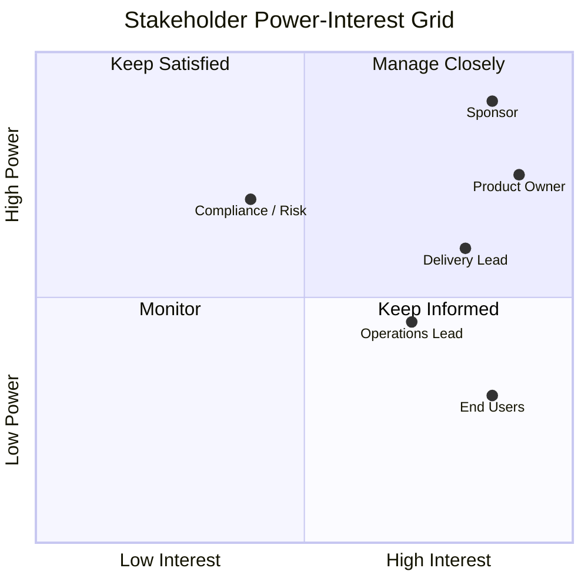

# Stakeholder & RACI Mapping

## Overview

Produce three connected artifacts: a **stakeholder register**, a **power/interest grid**, and a **RACI matrix**. Together they answer who the stakeholders are, how to position them, and who is Responsible, Accountable, Consulted, or Informed for each activity or deliverable.

Keep this skill focused on identification, classification, and responsibility mapping. Hand the downstream engagement and communication outputs to the **stakeholder-communications** skill — do not build a full communication plan here. Reference engagement need only as a classification on the register (the column described below).

Stay domain-neutral. Use generic role names (Sponsor, Product Owner, Business Analyst, Delivery Lead, Subject Matter Expert, Operations Lead, Compliance/Risk, End Users) rather than industry-specific titles, unless the user supplies their own.

## Workflow

1. Gather the minimum context:
   - the initiative, project, or decision being mapped
   - the activities, deliverables, or decisions that need responsibility assignment
   - the roles or named individuals involved (use roles when names are unknown)
2. Build the **stakeholder register** (see structure below). One row per stakeholder.
3. Classify each stakeholder on **power and interest**, then render the **power/interest grid** as a Mermaid quadrant chart.
4. Build the **RACI matrix**: rows are activities/deliverables, columns are roles. Apply the RACI rules.
5. Validate against the rules and the `## Gotchas` list before returning.
6. Output the RACI both as a Markdown table (for review in the document) **and** as a parallel `.csv` file (Excel-openable and git-diffable).

## Stakeholder register

One row per stakeholder. Recommended columns:

| Column | Description |
|---|---|
| Stakeholder | Individual name or role |
| Role / Position | Their function on the initiative |
| Group / Department | Team or organization |
| Interest | What they care about in this initiative |
| Influence (power) | Their power to affect the outcome — High / Medium / Low |
| Impact | How much the outcome affects them — High / Medium / Low |
| Current attitude | Supportive / Neutral / Resistant |
| Desired attitude | Where you need them to be |
| Engagement need | Manage closely / Keep satisfied / Keep informed / Monitor |
| RACI role | Their dominant R, A, C, or I across key deliverables |

The **Engagement need** column is a classification only — the detailed engagement and communication plan belongs to **stakeholder-communications**.

## Power/interest grid

Plot each stakeholder by interest (x-axis) and power/influence (y-axis). Render as a Mermaid quadrant chart, following the **common-mermaid-diagram** skill's conventions. Coordinates run 0–1.



Quadrant strategies:

- **Manage closely** (high power, high interest): regular engagement; involve in decisions.
- **Keep satisfied** (high power, low interest): periodic updates; clear escalation path.
- **Keep informed** (low power, high interest): regular communication; feedback channels.
- **Monitor** (low power, low interest): light touch; periodic updates.

## RACI matrix

### RACI definitions

| Letter | Role | Rule |
|---|---|---|
| **R** — Responsible | Does the work | At least one R per activity |
| **A** — Accountable | Ultimately answerable; has sign-off authority | Exactly ONE A per activity |
| **C** — Consulted | Gives input before the work is done (two-way) | As needed |
| **I** — Informed | Notified after the work is done (one-way) | As needed |

### Construction rules

1. Every row (activity / deliverable / decision) has **exactly one A**.
2. Every row has **at least one R**.
3. Minimize the number of C's — too many consultees slows decisions.
4. If someone is both R and A on a row, mark the cell `R/A`.
5. If a role has no letter in a row, they are simply not involved — leave the cell blank.
6. Scan for overload: if one role is R on nearly every row, that is a bottleneck — rebalance.

### Output format

Produce the matrix in **two parallel forms**:

1. A **Markdown table** in the document — rows are activities, columns are roles, cells contain `R`, `A`, `C`, `I`, `R/A`, or blank.
2. A parallel **`.csv` file** with the same content — Excel-openable and git-diffable. Use the same header row (activity column first, then one column per role) and one row per activity.

Do not produce `.xlsx`; CSV is the portable, diffable format for this library.

Optionally add a summary row counting R / A / C / I per role to spot overload.

## Worked example (neutral domain)

A small website-redesign initiative.

Markdown table:

| Activity | Sponsor | Product Owner | Business Analyst | Delivery Lead | Content SME | Operations Lead |
|---|---|---|---|---|---|---|
| Define requirements | A | C | R | C | C | I |
| Approve scope & budget | R/A | C | I | I | I | I |
| Design solution | I | C | C | R/A | C | I |
| Build & integrate | I | I | I | R/A | I | C |
| Migrate content | I | C | C | C | R/A | I |
| Go/No-Go decision | A | R | C | C | I | C |

Parallel `raci.csv` (same content):

```csv
Activity,Sponsor,Product Owner,Business Analyst,Delivery Lead,Content SME,Operations Lead
Define requirements,A,C,R,C,C,I
Approve scope & budget,R/A,C,I,I,I,I
Design solution,I,C,C,R/A,C,I
Build & integrate,I,I,I,R/A,I,C
Migrate content,I,C,C,C,R/A,I
Go/No-Go decision,A,R,C,C,I,C
```

Each row has exactly one A (or R/A) and at least one R.

## Gotchas

- **More than one A on a row.** Accountability must be singular — split the activity or pick the one role with final sign-off authority.
- **No A on a row.** Every activity needs an accountable owner; a row with only R's has no one answerable for the outcome.
- **No R on a row.** Nothing gets done — assign at least one Responsible role.
- **Everyone Consulted.** A wall of C's stalls delivery. Reserve C for roles whose input genuinely changes the work; downgrade the rest to I.
- **One role Responsible for everything.** That role is a bottleneck and a single point of failure — redistribute the work.
- **Confusing R/A with two separate roles.** When the same role does the work and signs off, use `R/A` in one cell, not an A in one column and an R in another.
- **Treating Consulted as Informed.** Consulted is two-way input *before* the work; Informed is one-way notification *after*. Don't mix them.
- **Building a communication plan here.** Engagement cadence, channels, and messaging belong to **stakeholder-communications** — this skill stops at the register's Engagement need classification.
- **Drifting into industry-specific roles.** Keep role names generic unless the user provides their own.
